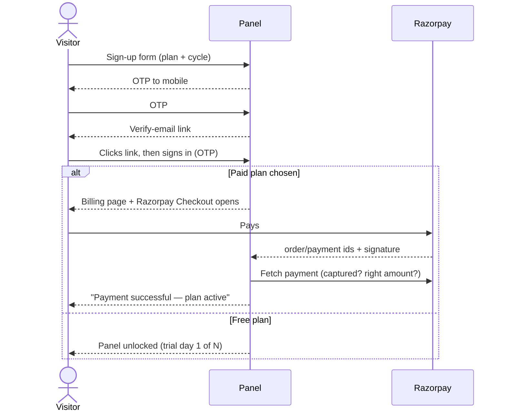

# Product Requirements Document (PRD)

This document lists what each module must do. The IDs (`FR-xx`) can be referenced from tickets and test cases. The [root README](../README.md) shows how each feature looks to a user.

---

## 1. Roles and permissions

| Permission | Super admin | Admin | Editor | Viewer |
|------------|:-:|:-:|:-:|:-:|
| `view` — see everything in the organisation | ✓ | ✓ | ✓ | ✓ |
| `create` — add things (any `POST`) | ✓ | ✓ | ✓ | — |
| `edit` — change things (any `PUT`), open the terminal, see secret values | ✓ | ✓ | ✓ | — |
| `delete` — remove things (any `DELETE`) | ✓ | ✓ | — | — |
| `members` — manage people, choose and pay for the plan | ✓ | ✓ | — | — |
| `orgs` — organisations, plans, platform console | ✓ | — | — | — |

- **FR-R1:** Permissions are enforced by the API on every request. The UI hides controls a role cannot use, but the API is the authority.
- **FR-R2:** Some `POST` endpoints only read (test a connection, collect facts, verify a credential, browse a database). These stay open to viewers through an explicit allowlist.
- **FR-R3:** The only super admin cannot be deleted, demoted or disabled.
- **FR-R4:** Changing a person's role, status or password ends all of that person's sessions immediately.

## 2. Modules and functional requirements

### 2.1 Accounts and sign-in

| ID | Requirement |
|----|-------------|
| FR-A1 | First run (no accounts): a setup form creates the super admin and the first organisation. `SUPER_ADMIN_*` in `.env` can also enforce the owner account on every boot. |
| FR-A2 | Self sign-up (when `ALLOW_SIGNUP=true`) collects name, email, mobile, password, company, a plan and a billing cycle, plus acceptance of the Terms. |
| FR-A3 | Sign-up proves the mobile number with a 6-digit one-time code (OTP), with resend limits and expiry (`OTP_MINUTES`), and signs straight in. Sign-in offers two tabs: **Email & password** (signs in directly) or **Mobile & OTP** (a code sent to the number; on with `OTP_MODE=random`, or with `OTP_LOGIN=on`). A number on several accounts must use email. When sign-up is open, an email or number with no account is told so and the card switches straight to the sign-up form with it filled in (both tabs); when sign-up is closed, it gets the same "do not match" answer as a wrong password and never receives a code. |
| FR-A4 | A new account is emailed a verification link and may **verify later**: it continues to payment and the dashboard, which shows an "Email verification pending" banner with **Resend link** until the link is clicked. |
| FR-A5 | Sessions use an HttpOnly cookie and last `AUTH_SESSION_DAYS` (default 14). |
| FR-A6 | Admins and super admins must add a mobile number before they continue. |

### 2.2 Plans, billing and payments

| ID | Requirement |
|----|-------------|
| FR-B1 | The billing page shows the current plan, trial progress, usage against limits, available plans (monthly/yearly toggle) and payment history. |
| FR-B2 | Choosing a free plan activates it at once (only if the organisation has never used the free trial). |
| FR-B3 | Choosing a paid plan, with Razorpay configured, **opens Razorpay Checkout directly**. With no keys configured, it creates a request for the super admin. |
| FR-B4 | After checkout the server verifies the signature and the captured payment, then activates the plan and shows a **"Payment successful — your plan is active"** dialog with plan, amount, renewal date and payment ID. |
| FR-B5 | If checkout closes without an answer, the server asks Razorpay whether the payment went through and activates the plan if so. |
| FR-B6 | Razorpay's webhook (`payment.captured`, `order.paid`, `payment.failed`) completes or fails orders independently of the browser. |
| FR-B7 | A paid plan picked at sign-up opens Razorpay automatically on first sign-in, once per request per browser. |
| FR-B8 | Payment history lists paid, failed and incomplete payments with date, plan, method, reference, status and amount. |
| FR-B9 | An ended plan locks every page except Plan & Billing. Nothing is deleted. |
| FR-B10 | Creating a resource over a plan limit is refused with a message naming the limit. |

### 2.3 Servers

| ID | Requirement |
|----|-------------|
| FR-S1 | Add a server with host, port, username and a password or private key (with optional passphrase and sudo password). Test the connection before saving. |
| FR-S2 | Collect a **system profile** (hardware, storage, network, ports, processes, services, updates, security, tooling, Docker, MySQL) and keep each collection as a snapshot. |
| FR-S3 | Health monitor: a TCP probe of the SSH port every 5 s, plus a real sign-in check every 10 min. Show the result as online/offline and "cannot sign in". |
| FR-S4 | Live view: CPU, memory, network, disk I/O and processes, streamed while the tab is open. Its headline tiles show each number with a small bar (as on a server card), not a chart, and the Live view has no history chart. Samples are still recorded every 5 min and kept 35 days: they set the health level on server and app cards, and an app's page keeps its *Statistics* chart (CPU and memory over a day, week or month). |
| FR-S5 | Pin the host key on first use. A changed key blocks the connection until an admin resets it. |
| FR-S5a | **Setup file for a blank machine.** The "Start from a blank machine" guide generates one Bash script (`aj-pilot-setup.sh`) from ticked options: SSH (always) and its port, never sleep, lid ignored, console blanking, Wi-Fi power save off, Wake-on-LAN, time zone + NTP, ufw (SSH, optionally 80/443), fail2ban, unattended upgrades, passwordless sudo for the invoking user, swap under 4 GB, Docker (opt-in), hostname and an SSH public key (optional). The script re-runs safely, detects VM / container / laptop / Wi-Fi / GRUB / systemd and skips what does not apply, validates SSH and sudoers changes and rolls them back on failure, waits for the apt lock, checks the network, refuses non-Ubuntu/Debian, supports `--dry-run` and `--help`, logs to `/var/log/aj-pilot-setup.log`, and ends with a per-step summary plus the address, port and username to enter in the panel. |
| FR-S5b | **Public server-setup guide.** The home page has a "Server setup" section (linked in the header menu and footer) with the whole path — download Ubuntu Server, write the USB stick, install with OpenSSH, get and run the setup file, connect in the panel — and a download button for the default file. The same guide is a docs page (`/docs/ubuntu-server-setup`, first in *Getting started* and linked in the docs header menu). Both use the public `/setup/aj-pilot-setup.sh`, so a new machine can fetch the file with one `curl` command. |
| FR-S6 | Server tabs: Overview, Storage (file manager), Network, Processes, System, Live, Apps, Docker, Nginx, Nginx Logs, Cron, Users, Services, Runners, Terminal. The counts beside Apps, Docker, Nginx, Cron, Users, Services and Runners show as soon as the page opens — without opening each tab — and refresh every 8 seconds while the page is on screen (paused in a hidden browser tab); a red count means something there needs attention. |
| FR-S7 | **Terminal:** an interactive shell in the browser (xterm.js over WebSocket), for roles with `edit`. It closes after 30 min with no input; a user can have at most 5 open. Opening and closing are logged; keystrokes are not. |
| FR-S8 | Reboot the server (`edit`). |
| FR-S9 | **Connectors:** a downloadable program for a user's PC that relays SSH to servers only that PC can reach (behind a VPN). The panel tries direct SSH first and falls back to a connector automatically. |

### 2.4 Server administration

| ID | Requirement |
|----|-------------|
| FR-SA1 | systemd: list, start/stop/restart/enable units, read the journal, create units. Delete only units the panel created. |
| FR-SA1a | Services tab layout: counters (running, failed, stopped, on boot, created here, all) that act as filters; a banner naming failed units with Restart and Logs; rows with a state dot, friendly name and description, an on-boot switch and actions, failed first then created-here; units that keep the server reachable marked. The detail dialog carries Start / Stop / Restart / Delete. The add form has four steps (what to run with command templates and a live absolute-path warning; where and as whom; environment; keep it running as choice cards with boot / start-now switches) and an Advanced section (type, after, overwrite). |
| FR-SA2 | Cron: list jobs and add, edit and remove them in user crontabs. Install cron if it is missing. Each job shows its schedule in plain English and its next run, computed on the server's clock and time zone; jobs are grouped as Your jobs / System / Scripts / Log, with a search. |
| FR-SA3 | Ubuntu users: add, edit, lock and delete users; set passwords and sudo; add and remove SSH keys; generate key pairs (the private key is shown once and never stored). |
| FR-SA4 | File manager: browse, read, edit, upload (up to 50 MB), download, move, copy, chmod, extract and delete, as root. |
| FR-SA5 | Nginx: install it, test and reload (reload is refused if the config test fails), manage sites and upstreams, issue and renew Let's Encrypt certificates. |
| FR-SA5a | Nginx tab layout: a one-line health header (running, version, ports, config test, auto-renew) with the main actions; counters for domains, SSL-secured, needing attention (no SSL, certificate < 14 days, disabled) and certificates; domains as searchable, filterable cards (All / Secure / Not secure / Disabled) naming the AJ Pilot app a site proxies to; load balancing, ports & proxies and certificates in collapsible sections. Upstreams show as cards with a health pill, the balancing method in plain words, each server's state, owning AJ Pilot app and share of traffic (by weight, excluding backup and paused servers), and the sites using it. The upstream dialog has three steps (name; servers with one-click chips for the server's apps and listening ports; balancing as choice cards), with per-server failure limits and keepalive under "More". Certificates: a status strip (certbot version and nginx plugin, auto-renew with a "Turn on" action that re-runs the certbot install to enable `certbot.timer`, healthy / expiring / expired counts), a banner with "Renew everything due" when any need attention, and cards sorted by expiry with days left, a 90-day lifetime bar, domains, the nginx sites using the certificate and Renew. The Get SSL dialog shows a before-you-start checklist with the server's address, chips for unsecured domains, a redirect switch and staging under Advanced. The Add domain dialog starts with three choice cards (AJ Pilot app, port, static folder), shows the A-record target, and keeps rare settings under Advanced. |
| FR-SA6 | Nginx logs: analyse access and error logs, block IPs, set up fail2ban. |
| FR-SA7 | Docker: containers (inspect, logs, start/stop/remove), networks, volumes, registry login. |
| FR-SA7a | Docker tab layout: a status header (engine running and version, Compose, registry) with the main actions; counters for running and stopped containers, volumes and networks; containers first as cards (state edge, owner mark app / installed / other, name, status, image, published ports as chips linking to `http://server:port`, actions) with search and All / Running / Stopped / Apps / Installed filters, troubled containers first; installed services, volumes, networks and registry as collapsible sections that stay open across refreshes; a container's name or *Details* opens its own page (FR-SA7b), not a popup. Each volume in the Volumes section has *Download* (`edit`). Live usage: each running card shows CPU (share of the server), memory (bar against its limit), network rx/tx, block I/O and PIDs; a Docker usage strip totals CPU and memory, names the busiest container and shows `docker system df` (images, containers, volumes, build cache, reclaimable). Loaded after the page, refreshed every 15 s while the tab is visible, with a pause control. |
| FR-SA7b | **Container page** (`#/servers/:id/containers/:name`, survives refresh and the back button): a header with a link back to the server's Docker tab, state and health badges, Start / Stop / Pause / Resume / Restart / Remove, and a **Download** menu (`edit`) with *Compose file (YAML)* and *Backup (.tar.gz)*. Tabs: **Overview** (state, restarts, size, image, command, limits, labels); **Live stats** (CPU, memory against limit, network and disk I/O rates with sparklines, PIDs, uptime, restarts, every 3 s); **Logs** (live: the last 200 lines then new lines as they are written, picked up again after a stop or restart; follow — dropped when you scroll up, restored at the bottom — pause, clear, filter, timestamps on/off, error and warning lines coloured, the newest 5,000 lines kept, and *Download .log*); **Volumes** (every mount: named volumes with size, mountpoint, other containers using it and *Download* (`edit`); bind mounts and tmpfs listed with their host path); **Ports & networks**; **Environment** (names only); **Processes**. Live stats and logs come over one stream that stops when the page is left. |
| FR-SA7c | **Container downloads** (`edit`, written to the activity log). *Compose file*: a `docker-compose.yml` rebuilt from `docker inspect` — image, command, environment **with values**, ports, volumes and bind mounts, networks, restart policy, limits, labels, healthcheck — so the container can be recreated with `docker compose up -d`. *Backup*: one `.tar.gz` with that compose file, the raw `inspect.json`, a `README.txt` with restore steps, and one `volumes/<name>.tar.gz` per volume the container uses (named or anonymous); bind-mounted host folders are listed in `README.txt` but not copied. An option pauses the container while the volumes are copied, for a consistent copy of a database. *Volume download*: one named volume's contents as `<volume>.tar.gz`. |

### 2.5 Installations

| ID | Requirement |
|----|-------------|
| FR-I1 | The catalog has Docker, Docker Compose and Nginx (installed on the host; Nginx needs no Docker) and MySQL, PostgreSQL, MongoDB, Redis, EMQX and Elasticsearch (as containers). |
| FR-I2 | The user chooses the port, version, network and credentials. Ports can be changed later. Passwords are encrypted at rest. |
| FR-I1a | Each catalog entry lists what must already be on the server (Docker for containers and Compose, Nginx for the log analyzer). The install form checks the chosen server first and, when something is missing, warns and offers to install it there first; the API refuses the install too. |
| FR-I3 | Removing an installation keeps its data volume unless the user explicitly asks to delete it. |

### 2.6 Apps (custom services)

| ID | Requirement |
|----|-------------|
| FR-D1 | Inspect the repository through the git API before cloning. Refuse it if there is no `package.json` or no start command, and say why. |
| FR-D2 | Detect the project type (Next.js, NestJS, Nuxt, Node service, Angular, React/Vite/Vue, static), the Node version, the package manager and the build/start commands. All are editable. |
| FR-D3 | Build a Docker image on the target server. Static front ends are served by nginx with an SPA fallback. A repository's own `Dockerfile` can be used instead; then no build or start command is required, since the Dockerfile provides both. |
| FR-D4 | Run one or several containers on chosen ports, with named volumes (default `<name>-data` at `/app/data`), environment variables, a network and a restart policy. |
| FR-D4a | The new-service form offers only servers whose status is `online`. A host port already published by another app on the same server, or already listening on the server, is flagged while typing and refused on create and on a container change, naming the holder. |
| FR-D4b | The app's environment variables are available to the build command as well as to the running containers, passed as a BuildKit secret (`id=appenv`) so they are never stored in an image layer. A repository's own Dockerfile receives the same secret and may mount it. |
| FR-D4c | A failed build is explained with the build's own error lines (type errors, missing modules, missing variables), not Docker's closing summary. |
| FR-D5 | The previous release keeps running until the new image has built. |
| FR-D6 | Deploys run in the background. The UI shows progress; a second deploy of the same app while one is running is refused; a deploy stuck for 40 minutes is released. |
| FR-D7 | Optionally push the image to Docker Hub. |
| FR-D8 | Per app: redeploy, logs (container and build), environment editor (`edit` only), container set changes, start/stop/restart, remove (volumes kept unless chosen). |
| FR-D9 | **Auto deploy:** by webhook or polling, on every commit or only on merges, for the app's branch. Each run is recorded with its commit/PR, author, status and log. |
| FR-D10 | **Domains:** attach a domain using Cloudflare DNS + nginx + Let's Encrypt, a Cloudflare tunnel, or **direct nginx** (no Cloudflare: the customer points DNS themselves; SSL optional). Retry or remove it. |
| FR-D10a | **Direct nginx domains** can be added while creating an app, from the app's page, or from a server's Nginx tab ("A custom app on AJ Pilot": choose server → app → container). With SSL required, the setup waits for the domain to resolve to the server and fails with a clear "point an A record at …" message if it does not; without SSL the app is served on HTTP. |
| FR-D10b | The Nginx tab's plain **Add domain** form has an **SSL required** option that requests a certificate right after the site is written. |
| FR-D11 | Git tokens in clone URLs are base64-encoded in transit and scrubbed from every stored or displayed log. |
| FR-D12 | **Usage:** each app card shows the app's CPU, memory and network (refreshed every 20 s while visible). The app's *Live stats* tab streams CPU, memory, network and disk I/O every 5 s for the app and each container (state, uptime, PIDs, restarts, health, OOM kills), and warns when a container is down, restarting, unhealthy or near a limit. The Overview shows the app's CPU and memory history over a day, week or month. |

### 2.7 Databases

| ID | Requirement |
|----|-------------|
| FR-DB1 | Connect to MySQL, PostgreSQL, MongoDB, Redis and Elasticsearch, directly or tunnelled through a server's SSH. |
| FR-DB2 | Overview statistics; browse databases, tables and collections; manage databases, users, grants and settings. |
| FR-DB3 | The query console is **read-only**. |
| FR-DB4 | Redis: find keys with SCAN (never KEYS), read large values page by page, edit and delete keys. |
| FR-DB5 | Elasticsearch: connect over HTTP or HTTPS with the `elastic` user (or none when security is off). Show cluster health, nodes, heap, disk and shards; list indices (system indices hidden from changes); create an index with shard and replica counts; delete an index after its name is typed back; per index show documents, size, shards, aliases, settings and field mappings; per field show how many documents have it and its top values. Manage security users (create, password, enable / disable, delete) and give them a built-in or custom role, or read / write / full access to an index pattern. Change a short list of persistent cluster settings. Query console takes Dev Tools syntax (`GET /path` plus an optional JSON body) and allows only `GET` and search-type `POST` requests. |
| FR-DB6 | Installing Elasticsearch from Installations adds its connection under Databases by itself, as the `elastic` user when a password was set. |

### 2.8 Accounts and integrations

| ID | Requirement |
|----|-------------|
| FR-C1 | Git: connect GitHub, GitLab and Bitbucket by OAuth (with PKCE and token refresh) or by pasting a token. Supports self-hosted GitHub Enterprise and GitLab. |
| FR-C2 | Docker Hub and Cloudflare: guided creation of a personal token, then verify and browse (repositories and tags; zones and DNS records; Zero Trust). |
| FR-C3 | CI runners: register and install GitHub/GitLab self-hosted runners on a server, check their status, control and remove them. |
| FR-C4 | Environments: named, encrypted sets of variables, created by importing a `.env` file, duplicated, and attached to apps and installations. Viewers see key names only. |

### 2.9 Teams and audit

| ID | Requirement |
|----|-------------|
| FR-T1 | Admins add, edit and remove members of their own organisation and assign roles (never super admin). |
| FR-T2 | The activity log records every change, with the organisation and the user who made it. |

### 2.10 Platform console (super admin)

| ID | Requirement |
|----|-------------|
| FR-P1 | Dashboard: organisations, subscriptions, revenue (this month vs last month), recent payments. |
| FR-P2 | Organisations: create, edit, suspend, delete; set the plan and its expiry; accept or decline requests; record payments; enter an organisation to work inside it. |
| FR-P3 | Plans: create, edit, archive; set prices, currency, limits, features, visibility and the highlight flag. |
| FR-P4 | Admins and users: manage platform admins and move users between organisations. |
| FR-P5 | Leads CRM: list, filter, analytics, notes, status pipeline, locate by IP, convert to an organisation. |

### 2.11 Public site

| ID | Requirement |
|----|-------------|
| FR-W1 | A server-rendered landing page with live pricing, FAQ, structured data (JSON-LD), sitemap and robots.txt. The header menu holds Features, How it works, Server setup, Pricing, Docs and Contact, plus a single **Sign in** button (no separate Sign up — sign-in leads a new visitor to sign-up, see FR-A3); FAQ and Terms are linked from the footer only. |
| FR-W2 | Public documentation at `/docs` and `/docs/<slug>`, with the same guides inside the app. |
| FR-W3 | A rate-limited lead form that captures UTM and referrer data and silently ignores bots (honeypot field). |
| FR-W4 | Terms & Conditions page, versioned (`TERMS_VERSION`). |

## 3. Key user journeys

### 3.1 Sign up and pay

### 3.2 Bare server to live app

1. **Add server** (SSH credentials), then the panel collects the system profile.
2. **Install Docker** from Installations.
3. **Connect a git account** (OAuth).
4. **+ Custom service**: pick the repo and branch, review the detected settings, then **Build & deploy**.
5. **Add a domain**: Cloudflare DNS + nginx + Let's Encrypt run automatically — or, without Cloudflare, direct nginx with optional SSL after the customer points the A record.
6. Optionally **turn on auto deploy** for the branch.

### 3.3 Run a command on a server

Server page → **Open terminal** → an interactive shell as the server's SSH user. The shell keeps running while the user moves between tabs and closes when they leave the server page.

## 4. Non-functional requirements

| Area | Requirement |
|------|-------------|
| Security | Every secret is encrypted with AES-256-GCM at rest; no API returns a stored secret, except where `edit` is explicitly required (environment values, server secrets). |
| Tenancy | Every query is scoped by the requester's organisation. |
| Responsiveness | API calls answer in under a second; long work (deploys, installs) runs in the background with progress shown. |
| Reliability | A failed build leaves the previous release running; payments are idempotent; the health monitor writes only on state changes. |
| Usability | Loading states use skeleton placeholders shaped like the content; light and dark themes. Every page works from 375px wide: on a phone the menu is a slide-in drawer, button rows wrap, figures sit two per row and wide tables scroll inside their card with an edge shadow showing there is more; up to 1100px the sidebar starts as an icon rail. |
| Accessibility | Dialogs trap focus; loading placeholders are announced to screen readers; reduced motion is respected. |
| Portability | No agent on managed servers; only SSH. The UI has no build step. |
