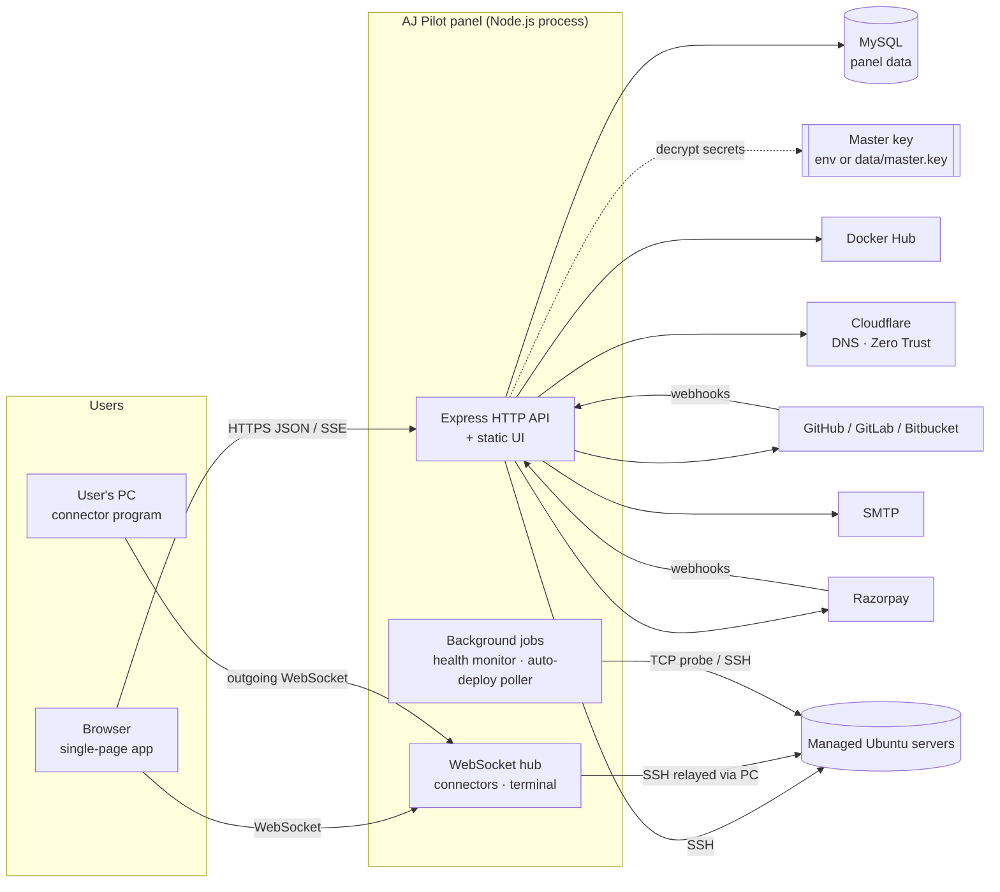
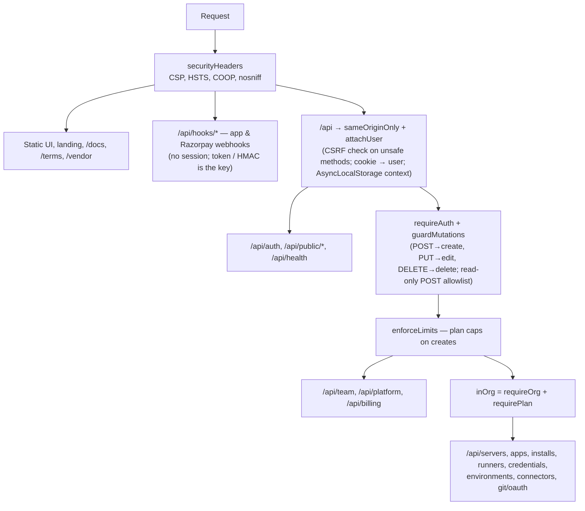
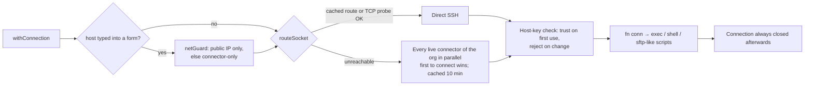
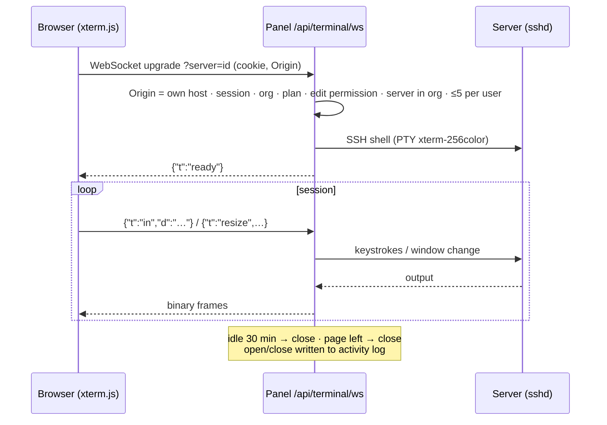
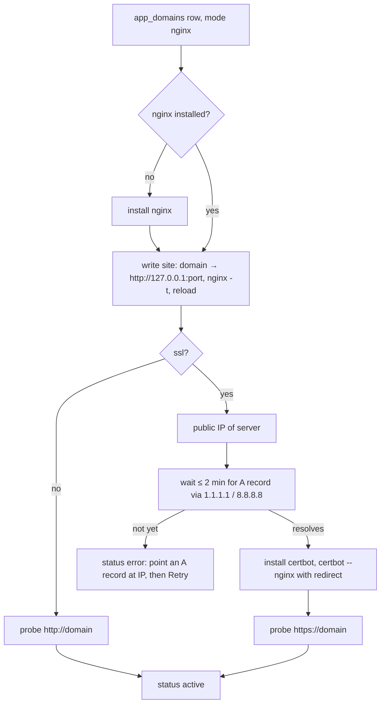
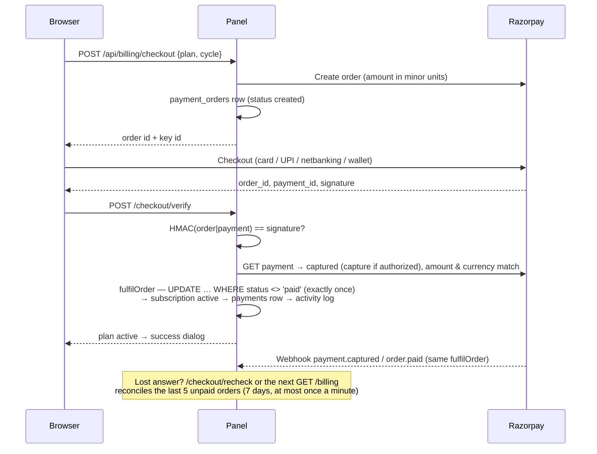
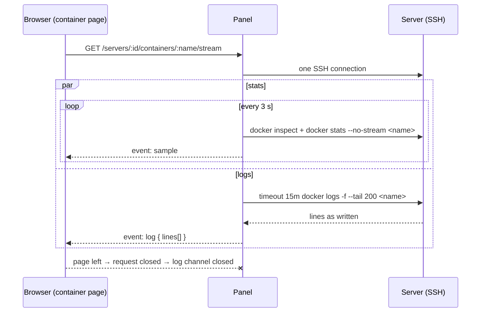

# System Design (High-Level Design)

## 1. Context



The panel is the **only** component the product ships. Managed servers need nothing beyond an SSH daemon. Everything that happens on a server is a command or script sent over SSH.

## 2. Technology choices

| Concern | Choice | Reason |
|---------|--------|--------|
| Server runtime | Node.js ≥ 20, Express 4, ES modules | One language end to end; strong SSH and DB client libraries |
| UI | Plain JavaScript SPA in `public/`, no bundler | No build step; served as static files |
| Panel database | MySQL 8 via `mysql2` pool | Relational data, JSON columns for profiles and settings |
| SSH | `ssh2` | Exec, interactive shells (PTY), custom sockets for the connector relay |
| Real-time | `ws` (WebSocket), SSE | Two-way streams for terminal and connectors; one-way stream for live stats |
| Managed databases | `mysql2`, `pg`, `mongodb`, `redis`; Elasticsearch over its REST API with `node:http(s)` | Native clients (plain HTTP for Elasticsearch), optionally over an SSH tunnel |
| Email | `nodemailer` | SMTP; falls back to the server log when unset |
| Terminal UI | `@xterm/xterm` + fit addon | Served from `node_modules` at `/vendor/…`, so the CSP needs no CDN |
| Legacy | `better-sqlite3` | One-time import from the old SQLite store |

## 3. Source layout

```
src/
  index.js            app wiring: middleware order, routers, webhooks, startup
  config.js           environment → config object, master key
  db/index.js         pool, schema creation, migrations, query helpers, activity log
  db/importSqlite.js  one-time import from the SQLite version
  routes/             HTTP API, one router per area (see API Reference)
  lib/                domain logic, one module per concern (below)
  lib/engines/        PostgreSQL, MongoDB, Redis, Elasticsearch drivers behind one shape
public/
  index.html, app.js, styles.css   the SPA (landing page + panel)
  connector/aj-pilot-connector.mjs the downloadable connector
  docs/                            media for the public guides
docs/                 these documents
```

### 3.1 Library modules by responsibility

| Area | Modules |
|------|---------|
| Identity and access | `auth` (scrypt, sessions, roles), `authGuard` (session → user, permissions), `context` (AsyncLocalStorage), `verification` (OTP, email links), `superAdmin`, `terms` |
| Tenancy and commerce | `organisations`, `plans` (subscriptions, limits, trial), `razorpay` (orders, verification, webhook, reconciliation) |
| Server access | `ssh` (connect, route, exec, root exec, host keys), `connectorHub` (PC relay over WebSocket), `netGuard` (blocks private targets), `terminal` (interactive shell) |
| Server knowledge | `probe.sh` + `systemInfo` (profile), `liveStats`, `healthMonitor`, `serverSummary` |
| Server onboarding | `setupScript` — builds the one-file `aj-pilot-setup.sh` for a blank Ubuntu machine from the guide's options (pure function, no SSH; served signed-in by `GET /api/servers/setup-script` and publicly, for the home page, docs and `curl` on a new machine, by `GET /setup/aj-pilot-setup.sh`) |
| Server administration | `services` (systemd), `cron`, `sysUsers`, `files`, `nginx`, `nginxLogs`, `docker` |
| Delivery | `nodeApp` (repo inspection, Dockerfile), `deploy` (remote build script), `autoDeploy` (webhooks and polling), `appDomain` (DNS/tunnel/direct nginx + certificate), `envVars`, `environments`, `catalog` (installable services) |
| Integrations | `git`, `gitAccounts`, `oauth`, `dockerhub`, `cloudflare`, `tunnel`, `runnerInstall`, `mysql`, `engines/*` |
| Public site | `landing`, `docs`, `docsPage`, `geoip`, `device`, `mailer` |
| Cross-cutting | `crypto` (AES-256-GCM), `security` (headers, CSP, same-origin, client IP), `envFile` |

## 4. Request pipeline

Order matters. It is set in `src/index.js`:



Every organisation-scoped query adds `WHERE org_id = ?` using the requester's organisation. A record from another organisation is reported as *not found*.

## 5. Executing work on a server

### 5.1 Connection routing



- **`exec`** runs one command and collects stdout, stderr and the exit code, with a timeout (`SSH_EXEC_TIMEOUT`).
- **`rootExec`** wraps a script so it runs as root. It uses `sudo` when the login user is not root, with the encrypted sudo password sent on **stdin**. Scripts are passed **base64-encoded**, so form input cannot break out of them.
- Names (units, containers, networks, users) are **validated against strict patterns**, not escaped.

### 5.2 Connectors

A connector is a small Node program on a user's PC. It opens an **outgoing** WebSocket to `/api/connectors/ws`, authenticates with a token (only the token's hash is stored), and then carries multiplexed TCP channels to the hosts the panel asks for. Nothing listens on the PC. One copy runs per token; a new token disconnects the old copy. A heartbeat detects dead links.

### 5.3 Browser terminal



The connector hub owns the HTTP `upgrade` listener and hands `/api/terminal/ws` to the terminal module.

## 6. Key flows

### 6.1 App deployment

```mermaid
sequenceDiagram
  actor U as User
  participant P as Panel
  participant G as Git provider
  participant S as Server
  U->>P: POST /api/apps/inspect (repo, branch)
  P->>G: Read package.json, lockfile, angular.json, Dockerfile
  P-->>U: Detected type, Node version, commands, port
  U->>P: POST /api/apps/ports (server, ports) while typing
  P->>S: ss -ltnH (who is listening)
  P-->>U: Ports taken, by which app or process
  U->>P: POST /api/apps (settings)
  P->>P: Same port check, 409 if taken
  P-->>U: Reply in under 1 s, card shows "in progress"
  P->>S: One script over SSH: clone → write Dockerfile → docker build → [push] → replace containers
  Note over S: Env vars reach the build as a BuildKit secret (temp file, mode 600, deleted after the build)
  Note over S: Old containers keep running until the image builds
  S-->>P: Exit status + log (tokens scrubbed)
  P->>P: apps.status = running / error, plus a deployments row
  U->>P: Polls status every few seconds while building
```



**Auto deploy** reaches the same deploy path from two triggers:

- a **webhook** at `/api/hooks/apps/:token` (GitHub push, GitLab push or merge-request hook, Bitbucket), or
- a **poller** that checks each app's branch head on a timer.

Both check the app's trigger (`push` = every commit, or `merge` = merged pull/merge requests only) and skip a SHA that has already been deployed.

### 6.1a App domain — direct nginx (no Cloudflare)

Reached from the create-app form, the app page, or a server's Nginx tab ("A custom app on AJ Pilot"). All three create an `app_domains` row with `mode: "nginx"` through the app routes; `setupDomain` then runs:



Removal deletes the nginx site and the certificate; there is no DNS record to remove, because the customer owns it.

### 6.2 Domain for an app

- **DNS mode:** Cloudflare A record → server's public IP → nginx site proxying to the app's port → Let's Encrypt certificate.
- **Tunnel mode:** Cloudflare Zero Trust tunnel (cloudflared) for servers with no inbound ports.

Each domain is an `app_domains` row with its own status and log, and can be retried or removed.

### 6.3 Plan payment



### 6.4 Health monitoring

- **Tier 1, every `HEALTH_CHECK_INTERVAL_SECONDS` (5 s):** a TCP connect to each server's SSH port, `HEALTH_CHECK_CONCURRENCY` at a time. Results are kept in memory. The database and activity log are written **only when the state changes**.
- **Tier 2, every `HEALTH_CHECK_SIGNIN_MINUTES` (10 min):** a real SSH sign-in that runs one command, to prove the stored credentials still work.
- The UI polls the lightweight `GET /api/servers/status` every 5 s and patches cards in place.

### 6.5 Live statistics

`GET /api/servers/:id/stats/stream` is a Server-Sent Events stream backed by one SSH session that samples `/proc` twice, one second apart, and computes rates on the machine itself. It is capped at `STATS_MAX_STREAMS` concurrent streams and `STATS_STREAM_MINUTES` per stream; the browser reconnects after that.

**Per app.** `liveStats.collectContainerStats(conn, server, names)` asks only for an app's containers: `docker inspect` (state, start time, restarts, health, OOM-killed) and `docker stats --no-stream` for the running ones, by name. `appUsage()` adds them up and expresses CPU and memory as a share of the host (Docker reports CPU per core, so 200% is two cores).

| Consumer | Endpoint | Cadence |
|----------|----------|---------|
| App cards | `GET /api/apps/stats` — one SSH session per server, every app on it in one pass; a failing server only marks its own apps | Browser polls every 20 s while the list is visible |
| App *Live stats* tab | `GET /api/apps/:id/stats/stream` (SSE), same lifecycle as the server stream, capped by `APP_STATS_STREAMS_PER_ORG` | Every 5 s |
| Server page tab counts | `GET /api/servers/:id/counts` — `serverSummary.collectTabCounts`, one SSH pass with counts only (containers, nginx sites + `nginx -t`, cron lines, systemd running/failed, runner units, people accounts) plus the app count from the database; the result (or the in-flight probe) is shared per server for 5 s | Browser polls every 8 s while the server page is visible; skipped in a hidden tab |

Network and block I/O come back as totals since the container started; the browser turns two samples into a rate.

**Per container (the container page).** `GET /api/servers/:id/containers/:name/stream` is one SSE stream over one SSH connection carrying two things: a `sample` every `?every=` ms (default 3000) from `collectContainerStats(conn, server, [name])`, and `log` events from a second channel on the same connection running `timeout <seconds left> docker logs -f --tail <n> --timestamps`. `docker logs -f` returns when the container stops, so `followContainer()` follows again every 4 s with `--since <last timestamp sent>` and drops lines at or before it (timestamps padded to nanoseconds to compare), so a stop, start or restart is picked up with no line repeated. The browser applies the same rule on an EventSource reconnect. It takes a slot from the same `STATS_MAX_STREAMS` / `STATS_MAX_STREAMS_PER_ORG` pool as the server stream and ends after `STATS_STREAM_MINUTES`; when the browser leaves the page the request closes, the log channel is closed, and the `timeout` wrapper guarantees `docker logs -f` cannot outlive the stream on the server.



**Container downloads.** `docker.js` builds them on the server and the panel streams the result back over SFTP (`files.sendTempFile`), deleting the temporary file afterwards:

| Download | How |
|----------|-----|
| Compose file | `docker inspect` of the container and its image → `composeFromInspect()` in the panel → `docker-compose.yml` text, sent directly. Settings equal to the image's defaults (environment, command, entrypoint, labels, healthcheck) are left out, `com.docker.compose.*` labels are dropped, and every `$` is doubled so compose does not interpolate it |
| Backup | A `mktemp -d` folder on the server gets `docker-compose.yml`, `inspect.json`, `README.txt` and `volumes/<name>.tar.gz` (`tar -czf -C <mountpoint> .`) per volume mounted (named or anonymous), optionally between `docker pause` / `docker unpause` (a `trap` unpauses on any exit); the folder is packed into one `.tar.gz` |
| Volume | `docker volume inspect` → `tar -czf -C <mountpoint> .` into a temp file |

### 6.6 Statistics history

`lib/metrics.js` runs a recorder every `METRICS_EVERY_MINUTES` (5): for each **online** server, `METRICS_CONCURRENCY` at a time, one `collectLiveStats` pass yields a server row and one row per app on it into `metric_samples`, each with a level (`ok` / `warning` / `critical`, from `THRESHOLDS` and `appLevel`). Rows older than `METRICS_KEEP_DAYS` (35) are pruned hourly. `metricSeries()` buckets them per hour (daily), 6 hours (weekly) or day (monthly) in the viewer's time zone for the Overview *Statistics* charts; `latestLevels()` gives the cards their current level. `METRICS_ENABLED=false` turns the recorder off.

## 7. Multi-tenancy

| Mechanism | Where |
|-----------|-------|
| `org_id` on every owned table; unique names per organisation | `src/db/index.js` (`addOrgScoping` migration) |
| Requester's organisation in AsyncLocalStorage | `authGuard.attachUser` → `context.js` |
| Every route filters by `req.orgId` | all routers (for example `getRow(id, orgId)`) |
| Super admin has no organisation unless one is opened (`active_org_id`) | `orgOf(user)` |
| Plan gate per organisation | `requirePlan`, `enforceLimits`, `blockIfExpired` |
| Connectors are only used for their own organisation's servers | `liveConnectorIds(orgId)` |

## 8. Front-end architecture

- One HTML document holds the landing page, the auth dialogs and every panel view. Views are `<section class="view">` elements that are shown and hidden.
- `app.js` is organised by feature, with section banners. Helpers include `api()` (fetch wrapper with error/plan handling), `show(view)`, `toast`, `askConfirm` / `openAsk` (themed dialogs), `table`, `tile` and `skeleton(kind)` (loading placeholders).
- **Routing:** the hash (`#/servers/12/docker`) mirrors the current page, so refresh, back and bookmarks work.
- **Theming:** CSS custom properties with light and dark sets; the user's choice is kept in `localStorage`.
- **Plan gate:** `body.needs-plan` locks navigation to Billing when there is no active plan.

## 9. Background and in-process state

| State | Lives in | Effect if the process restarts |
|-------|----------|-------------------------------|
| Health results | memory map + DB on change | Rebuilt within one sweep |
| Connector sessions | memory map | Connectors reconnect automatically |
| SSH route cache (direct vs connector) | memory map, 10 min TTL | Re-probed on next connection |
| Terminal sessions, live-stat streams | memory | Browser shows disconnected; user reconnects |
| Razorpay reconcile throttle | memory map | Reconciliation may run once more; harmless |
| Running deploys | `apps.deploy_started_at` | Released after 40 min |

Because this state lives in one process, the panel is designed to run as **one instance** (see [Limitations](08-limitations-and-roadmap.md)).

## 10. Error handling conventions

- JSON errors look like `{ error: "Human-readable sentence" }` with a meaningful status code: 400 validation, 401 not signed in (`needsAuth`), 402 plan required or ended (`needsPlan`, `trialExpired`), 403 permission, 404 not found or not yours, 502 upstream failure (Razorpay, git, Cloudflare).
- SSH errors are mapped to plain-language messages (`normalizeSshError`); a changed host key returns a specific instruction.
- Audit-log writes never fail the request they describe.
