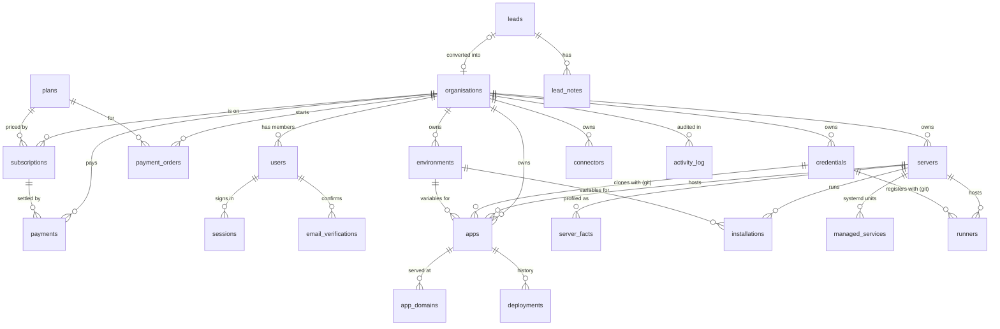

# Data Model

The panel keeps all of its data in one MySQL database (`DB_NAME`, default `auto_deploy`). The schema is created and migrated **automatically on boot** by `src/db/index.js`. There is no separate migration tool:

1. `CREATE TABLE IF NOT EXISTS` for each of the 25 tables.
2. `addOrgScoping`: adds `org_id` (+ index) to `servers, credentials, projects, runners, installations, apps, managed_services, activity_log`, and `user_id` to `activity_log`, on databases created before organisations existed. Orphan rows are moved into a "Default organisation".
3. Column additions via `ensureColumn` (for example `servers.host_key`, `users.phone`, `apps.auto_deploy`, `subscriptions.expires_at`).
4. Unique keys added once `org_id` exists: `uq_server_org_name (org_id, name)`, `uq_cred_org_provider_name (org_id, provider, name)`.

> Column types, indexes, constraints and migration rules are in [Database Design](09-database-design.md).
>
> Columns ending in `_enc` hold **AES-256-GCM ciphertext** (see [Security](06-security.md)). They are never returned by the API as stored.

## 1. Entity-relationship overview

## 2. Tables by domain

### 2.1 Identity and access

| Table | Purpose | Key columns |
|-------|---------|-------------|
| `organisations` | A tenant | `name` (unique), `slug`, `status` (`active` / `suspended`), `notes` |
| `users` | People | `org_id` (null for super admin), `active_org_id` (organisation a super admin has opened), `email`, `password_hash` (scrypt), `role` (`super_admin`/`admin`/`editor`/`viewer`), `status`, `phone`, `email_verified`, `terms_version`, `terms_accepted_at` |
| `sessions` | Signed-in sessions | `token_hash` (SHA-256 of the cookie token), `user_id`, `expires_at`, `ip`, `user_agent` |
| `auth_challenges` | OTP challenges for sign-in and sign-up | `token_hash`, `purpose`, `payload` (pending sign-up), `code_hash`, `channel`, `attempts`, `sends`, `expires_at` |
| `email_verifications` | Email confirmation links | `token_hash`, `user_id`, `email`, `expires_at` |

### 2.2 Commerce

| Table | Purpose | Key columns |
|-------|---------|-------------|
| `plans` | What is on sale | `name`, `slug`, `price_monthly`, `price_yearly`, `currency`, `limits` (JSON: `servers, apps, users, databases, domains`), `features` (JSON), `highlighted`, `is_public`, `sort_order`, `status` |
| `subscriptions` | An organisation's plan over time | `org_id`, `plan_id`, `cycle`, `amount`, `status` (`active, trial, past_due, pending, declined, withdrawn, cancelled, ended`), `started_at`, `renews_at`, `expires_at`, `ended_at`, `notes` |
| `payments` | Money received (online or recorded by hand) | `org_id`, `subscription_id`, `amount`, `currency`, `paid_at`, `method` (for example `razorpay/upi`, `Bank transfer`), `reference`, `created_by` |
| `payment_orders` | Razorpay orders and their outcome | `org_id`, `plan_id`, `user_id`, `cycle`, `amount`, `provider_order_id` (unique), `provider_payment_id`, `status` (`created` / `paid` / `failed`), `error`, `payment_id` → `payments.id`, `paid_at` |
| `leads` | Prospects from the public form | contact fields, `plan_id`, `cycle`, `utm_*`, `referrer`, `landing_path`, `ip`, `geo`, `device`, `status` (`new → contacted → qualified → proposal → won / lost`), `value`, `assigned_to`, `org_id` once converted |
| `lead_notes` | Notes and events on a lead | `lead_id`, `user_id`, `kind`, `body` |

**The current subscription** is the latest row with status in `active`, `trial` or `past_due`. A `pending` row is a plan request waiting for payment or approval.

### 2.3 Infrastructure

| Table | Purpose | Key columns |
|-------|---------|-------------|
| `servers` | Managed machines | `org_id`, `name` (unique per org), `host`, `port`, `username`, `auth_type` (`password` / `key`), `password_enc`, `private_key_enc`, `passphrase_enc`, `sudo_password_enc`, `host_key` (pinned fingerprint), `status`, `last_error`, `last_checked_at` |
| `server_facts` | System profile snapshots | `server_id`, `collected_at`, `duration_ms`, `payload` (JSON) |
| `managed_services` | systemd units the panel created | `server_id`, `unit`, `exec_start`, `unit_file` |
| `installations` | Catalog services on a server | `server_id`, `kind`, `image`, `tag`, `port`, `container_port`, `extra_ports`, `network`, `volume`, `settings`, `secrets_enc`, `environment_id`, `status`, `install_log` |
| `runners` | CI runners | `credential_id` (git), `server_id`, `kind` (GitHub/GitLab), `scope`, `target`, `labels`, `service_name`, `remote_id`, `status`, `install_log` |
| `connectors` | PC relays | `org_id`, `name`, `token_hash`, `hostname`, `platform`, `version`, `last_ip`, `last_seen_at` |
| `metric_samples` | CPU, memory, disk, load and network samples for the charts | `org_id`, `kind` (`server` / `app`), `target_id`, `at`, `cpu_pct`, `memory_pct`, `disk_pct`, `load_pct`, `net_rx_bps`, `net_tx_bps`, `level`. Kept for `METRICS_KEEP_DAYS` (35) |

### 2.4 Credentials and configuration

| Table | Purpose | Key columns |
|-------|---------|-------------|
| `credentials` | Every external account | `org_id`, `provider` (`git, dockerhub, cloudflare, mysql, postgres, mongodb, redis, elasticsearch`), `name` (unique per org and provider), `username`, `secret_enc`, `extra` (JSON: host, OAuth refresh data, account info), `server_id` (SSH tunnel for databases), `status`, `verified_at` |
| `environments` | Named variable sets | `org_id`, `name` (unique per org), `description`, `env_enc`, `var_count` |
| `projects` | Early placeholder linking a server, credentials, repo and domain | **Unused** by any route; `apps` replaced it. Candidate for removal |

### 2.5 Delivery

| Table | Purpose | Key columns |
|-------|---------|-------------|
| `apps` | Deployed services | `org_id`, `server_id`, `credential_id` (git), `registry_cred_id` (Docker Hub), `repo`, `branch`, `root_dir`, `app_type`, `node_version`, `install_cmd`/`build_cmd`/`start_cmd`, `port`, `container_port`, `instances`, `container_ports` (JSON), `volumes` (JSON), `env_enc`, `environment_id`, `image`, `tag`, `pushed`, `network`, `restart`, `use_repo_dockerfile`, `status`, `deploy_started_at`, `deploy_log`, `auto_deploy`, `auto_deploy_trigger` (`push` / `merge`), `webhook_token`, `deployed_sha`, `auto_seen_sha` |
| `deployments` | Each deploy run | `app_id`, `reason`, `user_id`, `branch`, `kind` (`commit` / `merge`), `sha`, `message`, `author`, `pr_number`, `pr_title`, `status`, `error`, `log`, `started_at`, `finished_at` |
| `app_domains` | Domains attached to apps | `org_id`, `app_id`, `domain` (unique per org), `port`, `config` (mode: dns / tunnel), `status`, `error`, `log` |

### 2.6 Monitoring

| Table | Purpose | Key columns |
|-------|---------|-------------|
| `metric_samples` | One sample per server and per app every `METRICS_EVERY_MINUTES`, for the Statistics charts and the cards' health level; pruned after `METRICS_KEEP_DAYS` | `org_id`, `kind` (`server` / `app`), `target_id`, `at` (UTC), `cpu_pct`, `memory_pct`, `disk_pct` (servers), `load_pct` (servers, load per core × 100), `net_rx_bps` / `net_tx_bps` (servers), `level` (`ok` / `warning` / `critical`) |

Live statistics (server *Live*, app *Live stats*, app card usage) are read over SSH on demand and never stored.

### 2.7 Audit

| Table | Purpose | Key columns |
|-------|---------|-------------|
| `activity_log` | Every change and notable event | `entity`, `entity_id`, `action` (for example `plan_chosen`, `payment_online`, `went_offline`, `terminal_opened`), `level` (`info`/`warn`/`error`), `message`, `org_id`, `user_id`, `created_at` |

`org_id` and `user_id` are filled automatically from the request context, so callers never pass them.

## 3. Integrity and deletion

- Foreign keys cascade from `organisations` (users, subscriptions, payments, payment orders, environments). Deleting an organisation removes its people, subscriptions and payment records.
- Server-owned rows (`server_facts`, `installations`, `runners`, `managed_services`) reference `servers`. Deleting a server in the panel does **not** remove anything from the machine itself.
- Payment idempotency: `UPDATE payment_orders SET status='paid' … WHERE id = ? AND status <> 'paid'`. Only the call that changes the row goes on to activate the plan.

## 4. Data that is *not* in the database

| Data | Where it lives |
|------|----------------|
| Master encryption key | `APP_ENCRYPTION_KEY`, or `data/master.key` |
| Nginx sites, certificates, crontabs, systemd units, Docker state | On each managed server; the panel reads them live and keeps no copy |
| App source and images | On the managed server (`/opt/auto-deploy/apps/<name>`), and Docker Hub if pushed |
| Logs | Read live over SSH; build logs are stored in `apps.deploy_log` / `deployments.log` with tokens scrubbed |

## 5. Backup guidance

- Back up the **MySQL database** and the **master key**, separately. Either one alone is useless for restoring credentials.
- A `mysqldump --single-transaction` of `auto_deploy` is consistent with no downtime.
- After a restore with the same key, every credential works again. With a different key, every `_enc` column is unreadable.
