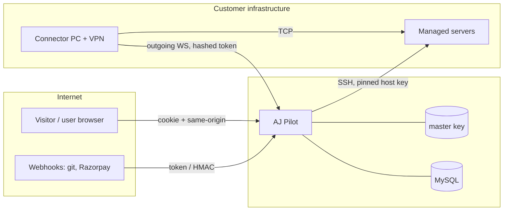

# Security Design

AJ Pilot holds **root-level access to its customers' servers** and the API tokens for their git, Docker Hub, Cloudflare and database accounts. A compromise of the panel is a compromise of every server it manages, so security is a core requirement.

## 1. Assets

| Asset | Where | Sensitivity |
|-------|-------|-------------|
| SSH passwords, private keys, passphrases, sudo passwords | `servers.*_enc` | Critical |
| Provider tokens (git, Docker Hub, Cloudflare, databases) | `credentials.secret_enc` | Critical |
| App and environment variables | `apps.env_enc`, `environments.env_enc` | High |
| Installed service passwords | `installations.secrets_enc` | High |
| Master encryption key | `APP_ENCRYPTION_KEY` / `data/master.key` | Critical |
| User passwords, sessions, OTPs | `users`, `sessions`, `auth_challenges` | High (stored only as hashes) |
| Payment records | `payments`, `payment_orders` | Medium (no card data is ever handled; Razorpay holds it) |

## 2. Threat model and controls

| # | Threat | Controls in place |
|---|--------|-------------------|
| T1 | **Database theft** exposes server credentials | AES-256-GCM with a random 12-byte IV per value; the key is kept outside the database; passwords hashed with scrypt; session, OTP and connector tokens stored only as SHA-256 hashes |
| T2 | **One tenant reads another's data** | Every query filtered by the requester's `org_id`; unique names per organisation; foreign ids return 404; connectors used only for their own organisation |
| T3 | **Privilege escalation** inside an organisation | The method → permission rule (`guardMutations`) runs on the server for every request; a narrow read-only allowlist; admins cannot create super admins; role, status or password changes end the user's sessions |
| T4 | **CSRF** | `SameSite=Lax` cookie, plus a same-origin check (`Sec-Fetch-Site`, `Origin`, `Referer`) on every unsafe `/api` request; the terminal WebSocket checks `Origin` itself, because a WS upgrade is a GET |
| T5 | **Credential stuffing / brute force** | Sign-in limits per IP (20 / 15 min) and per account (8 / 15 min); sign-ups per network limited; OTP: 5 wrong tries restart the flow, 5 sends at most; email resends limited |
| T5a | **Account enumeration** | With sign-up open, sign-in answers `404 noAccount` for an unknown email or number so the visitor can be sent to sign-up. This reveals nothing new: sign-up already answers `409` for an email or number in use, and both paths share the per-IP and per-login rate limits. The unknown-account path still runs a dummy password hash, so timing matches. With `ALLOW_SIGNUP=false` both sign-in routes keep the old answer — the same for a known and an unknown account |
| T6 | **Command injection** into server scripts | Generated scripts sent base64-encoded; names (units, containers, networks, users, images, ports) validated with strict patterns, not escaped; sudo password sent on stdin |
| T7 | **Secrets leaking into logs** | Clone URLs carry the token base64-encoded and masked; tokens scrubbed from every stored or displayed log line; the terminal never logs keystrokes |
| T7a | **App secrets baked into images** | Env vars reach `docker build` only through `--secret id=appenv` (BuildKit), mounted for the one `RUN` that builds; never `ARG`/`ENV`, so they are absent from image layers and `docker history`. The secret file is written base64-decoded to a `mktemp` file outside the build context, `chmod 600`, and removed right after the build whatever its outcome |
| T8 | **Man-in-the-middle on SSH** | Host key pinned on first use (`servers.host_key`); a different key blocks the connection with a clear message until an admin resets it |
| T9 | **SSRF**: the panel used to reach internal networks | `netGuard` resolves hosts typed into forms and blocks loopback, private and metadata addresses (`PRIVATE_TARGETS`); private targets are only reachable through the organisation's own connector |
| T10 | **Forged payments** | Checkout signature verified by HMAC; payment fetched from Razorpay and checked for captured status and exact amount and currency; webhook verified by HMAC over the raw body; the order is fulfilled exactly once |
| T11 | **Forged deploy webhooks** | Each app has a random webhook token in the URL; the deploy still only builds the app's configured branch |
| T12 | **XSS / clickjacking** | Content-Security-Policy (scripts from self and Razorpay only), `frame-ancestors 'none'`, `X-Frame-Options: DENY`, `nosniff`, HTML-escaping helpers (`esc`) in the UI; xterm.js served from the panel's own origin |
| T13 | **Session theft over the network** | HttpOnly cookie; `Secure` + HSTS when `AUTH_SECURE_COOKIE` is on (automatic when `SITE_URL` is https) |
| T14 | **Spoofed client IP** | `X-Forwarded-For` / `CF-Connecting-IP` trusted only when `TRUST_PROXY=true` |
| T15 | **Destructive mistakes** | Delete needs the `delete` permission; volumes kept unless explicitly removed; only units the panel created can be deleted; nginx reload refused when `nginx -t` fails; every change written to the activity log |
| T16 | **Abuse of the interactive terminal** | Needs `edit`, an active plan, a same-origin session and a server in the organisation; at most 5 per user; 30-minute idle timeout; open and close audited |
| T16a | **The machine setup file weakens a new server** | The script carries no secret from the panel (no tokens, no private keys — at most a *public* key the user pasted). Every option is validated server-side against strict patterns (port, IANA zone, hostname, Unix user, a single `ssh-ed25519`/`ssh-rsa`/`ecdsa-*` public key line) and embedded single-quoted. SSH password login is left as Ubuntu set it; the firewall allows SSH **before** it is enabled so the run cannot lock the user out; a changed `sshd` config must pass `sshd -t` and a sudoers drop-in must pass `visudo -cf`, otherwise the previous file is restored. Passwordless sudo is an explicit, visible option for the invoking user only (`/etc/sudoers.d/90-aj-pilot`, mode 0440). fail2ban and unattended security upgrades are on by default. The public copy at `/setup/aj-pilot-setup.sh` (no sign-in) is safe to expose for the same reason — it is the same generator with the same validation and no organisation data; the docs tell people to download it and read or `--dry-run` it before running it with sudo, rather than piping it straight into a root shell |
| T16b | **Container secrets leaving through downloads** | The compose file and backup carry environment values and volume data (database files, uploads), so all three downloads need `edit` — the same bar as the file manager's download, which can read those files anyway — and each is written to the activity log with the container or volume name. The details page and the live stream still never return environment values, and the command line stays hidden below `edit`. Container and volume names are validated against strict patterns before reaching a script; temporary files on the server are created with `mktemp`, readable only by the login user, and removed after streaming even when the transfer fails |
| T17 | **Writes through a database query console** | Each engine refuses writes before sending anything: PostgreSQL runs in a `READ ONLY` transaction that is rolled back, MongoDB refuses `$out` / `$merge`, Redis allows only listed read commands, Elasticsearch allows only `GET` and search-type `POST` paths, with no `..` and no whitespace in the path |

## 3. Cryptography

| Use | Algorithm |
|-----|-----------|
| Secrets at rest | AES-256-GCM (authenticated encryption), random IV per value |
| User passwords | scrypt with a random salt, constant-time comparison |
| Session, OTP challenge, email link and connector tokens | Random tokens; only SHA-256 stored |
| Razorpay checkout | HMAC-SHA256 of `order_id` + `\|` + `payment_id` with the key secret, constant-time compare |
| Razorpay webhook | HMAC-SHA256(raw body, webhook secret) |
| Git OAuth | State + PKCE |

## 4. Trust boundaries

## 5. Hardening checklist for production

| Item | Setting / action | Why |
|------|------------------|-----|
| HTTPS in front of the panel | nginx or Cloudflare; `SITE_URL=https://…` | Secure cookie and HSTS |
| Real OTP codes | `OTP_MODE=random` + an SMS provider | **The default `fixed` mode accepts `OTP_FIXED_CODE` (`123456`) for everyone** |
| Master key | Set `APP_ENCRYPTION_KEY`; store a copy in a secrets manager | Losing it loses every credential; a key file on the same disk as the DB backup defeats encryption |
| Private targets | `PRIVATE_TARGETS=block` on any panel with public sign-up | Stops tenants probing the panel's network |
| Proxy headers | `TRUST_PROXY=true` only behind a real proxy | Otherwise visitors can choose their own IP |
| Super admin | Strong `SUPER_ADMIN_PASSWORD`; add a phone | It owns the platform |
| Razorpay | Configure the webhook secret | Payments confirm even if the tab closes |
| Database | Dedicated MySQL user for `auto_deploy`, not root | Least privilege |
| Sign-up | `ALLOW_SIGNUP=false` for a private panel | Smaller attack surface |
| Backups | Encrypted DB backups and key kept apart | Recovery without exposure |

## 6. Known gaps and recommendations

| Gap | Risk | Recommendation |
|-----|------|----------------|
| Default `OTP_MODE=fixed` | Sign-up's mobile check proves nothing | Ship with `random`; integrate an SMS provider |
| Email + password signs in with no second step | A leaked password is enough to sign in | Offer optional TOTP or an OTP step for admins |
| Mobile & OTP sign-in rests on the code alone | Anyone who can read the SMS (SIM swap) can sign in | Keep `OTP_LOGIN` off while codes are fixed (the default); per-number and per-address rate limits are in place |
| Editors can open the terminal and call `POST /servers/:id/exec` | An editor can delete data on a server, beyond what their role suggests | Decide whether the terminal should need `delete` (admin) or a new `shell` permission |
| CSP allows `'unsafe-inline'` scripts | Weaker XSS protection | Move inline scripts to files, then use nonces |
| Rate limits are in memory | Reset on restart; not shared across instances | Use a shared store (Redis) if the panel ever scales out |
| No 2FA app (TOTP) or SSO | Depends on SMS and email | Add TOTP and optional OIDC SSO for teams |
| Activity log has no retention or export | Grows without limit; hard to hand to an auditor | Add retention and CSV export |
| Security tests cover the API only | Browser-side issues (XSS) are not tested | `npm test` covers tenancy, permissions, CSRF, SSRF guard, payment verification and terminal access; add browser tests for XSS |
