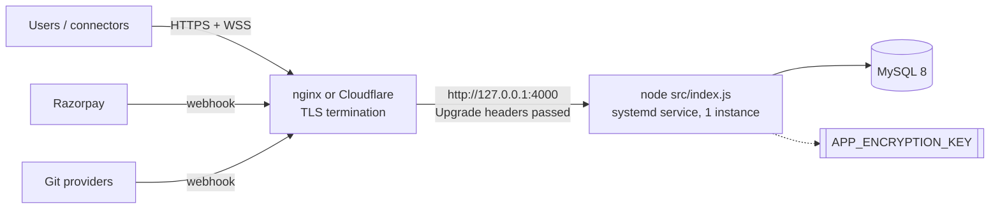

# Deployment & Operations Guide

This guide covers running the AJ Pilot panel itself. Managing the servers it controls is covered in the [root README](../README.md).

## 1. Requirements

| Component | Version / note |
|-----------|----------------|
| Node.js | ≥ 20 (22 LTS recommended). Connectors on users' PCs need Node 22+ |
| MySQL | 8.x; a user that can `CREATE DATABASE`, or an existing empty database |
| OS | Any OS that runs Node. Linux in production |
| Network out | SSH to managed servers; HTTPS to GitHub/GitLab/Bitbucket, Docker Hub, Cloudflare, Razorpay, `ipwho.is` (optional), SMTP |
| Network in | HTTPS 443 through a reverse proxy, **with WebSocket upgrades allowed** |

## 2. Production topology



Run **one** panel process (see [Limitations](08-limitations-and-roadmap.md)).

## 3. Installation

```bash
git clone <repo> /opt/aj-pilot && cd /opt/aj-pilot
cp .env.example .env        # fill in: DB_*, APP_ENCRYPTION_KEY, SITE_URL, SUPER_ADMIN_*, RAZORPAY_*, SMTP_*
npm ci --omit=dev
npm start                   # first boot creates the database and every table
```

Generate a master key once and keep it safe:

```bash
node -e "console.log(require('crypto').randomBytes(32).toString('base64'))"
```

### 3.1 systemd unit

```ini
# /etc/systemd/system/aj-pilot.service
[Unit]
Description=AJ Pilot panel
After=network-online.target mysql.service

[Service]
WorkingDirectory=/opt/aj-pilot
ExecStart=/usr/bin/node src/index.js
Restart=always
RestartSec=3
User=ajpilot
Environment=NODE_ENV=production

[Install]
WantedBy=multi-user.target
```

### 3.2 nginx reverse proxy

WebSockets carry **connectors** (`/api/connectors/ws`) and the **browser terminal** (`/api/terminal/ws`). Live stats use **Server-Sent Events**. All three need the proxy settings below:

```nginx
server {
  listen 443 ssl http2;
  server_name panel.example.com;
  # ssl_certificate … (Let's Encrypt)

  client_max_body_size 80m;          # file-manager uploads (50 MB, base64 in JSON ≈ 70 MB)

  location / {
    proxy_pass http://127.0.0.1:4000;
    proxy_http_version 1.1;
    proxy_set_header Upgrade $http_upgrade;     # WebSockets
    proxy_set_header Connection $connection_upgrade;
    proxy_set_header Host $host;
    proxy_set_header X-Forwarded-For $proxy_add_x_forwarded_for;
    proxy_set_header X-Forwarded-Proto $scheme;
    proxy_set_header X-Forwarded-Host $host;
    proxy_buffering off;                        # SSE live stats
    proxy_read_timeout 1h;                      # long-lived terminals and streams
  }
}
# in http {}:  map $http_upgrade $connection_upgrade { default upgrade; '' close; }
```

Then set `TRUST_PROXY=true` and `SITE_URL=https://panel.example.com`.

## 4. Configuration reference

The full list with comments is in [`.env.example`](../.env.example). The settings that matter most:

| Group | Variables | Production value |
|-------|-----------|------------------|
| Web | `PORT`, `HOST`, `SITE_URL`, `TRUST_PROXY` | `4000`, `127.0.0.1`, your https URL, `true` behind a proxy |
| Database | `DB_HOST`, `DB_PORT`, `DB_USER`, `DB_PASSWORD`, `DB_NAME`, `DB_POOL_SIZE` | Dedicated user |
| Secrets | `APP_ENCRYPTION_KEY` | **Always set explicitly**; back it up |
| SSH | `SSH_CONNECT_TIMEOUT`, `SSH_EXEC_TIMEOUT` | Defaults (15 s / 45 s) |
| Monitoring | `HEALTH_CHECK_*` | Defaults; lower concurrency for very large fleets |
| Live view | `STATS_MAX_STREAMS`, `STATS_MAX_STREAMS_PER_ORG`, `APP_STATS_STREAMS_PER_ORG`, `STATS_STREAM_MINUTES` | Defaults (8 / 4 / 4 / 15) |
| Statistics history | `METRICS_ENABLED`, `METRICS_EVERY_MINUTES`, `METRICS_KEEP_DAYS`, `METRICS_CONCURRENCY` | Defaults (`true` / 5 / 35 / 4); `metric_samples` grows by one row per server and app per sample |
| Sign-in | `AUTH_SESSION_DAYS`, `AUTH_SECURE_COOKIE` | 14; empty (follows `SITE_URL`) |
| OTP | `OTP_MODE`, `OTP_FIXED_CODE`, `OTP_MINUTES` | **`random`** |
| Email | `SMTP_*`, `MAIL_FROM`, `EMAIL_VERIFY_HOURS` | Real SMTP |
| Payments | `RAZORPAY_KEY_ID`, `RAZORPAY_KEY_SECRET`, `RAZORPAY_WEBHOOK_SECRET` | Live keys plus webhook to `<SITE_URL>/api/hooks/razorpay` (`payment.captured`, `order.paid`, `payment.failed`) |
| Tenancy | `ALLOW_SIGNUP`, `FREE_TRIAL_DAYS`, `PRIVATE_TARGETS` | As the business decides; `block` with public sign-up |
| Owner | `SUPER_ADMIN_EMAIL`, `SUPER_ADMIN_PASSWORD`, `SUPER_ADMIN_NAME`, `SUPER_ADMIN_PHONE` | Enforced on every boot |
| Git OAuth | `GITHUB_*`, `GITLAB_*`, `BITBUCKET_*`, `OAUTH_CALLBACK_BASE` | See README "Git settings in .env" |
| Geo | `GEOIP` | `ipwho.is` or `off` |

## 5. Operating the panel

### 5.1 Health and monitoring

- `GET /api/health` returns `{ ok: true }` when the process is up. Use it for uptime checks.
- Logs go to stdout/stderr (`journalctl -u aj-pilot`). Useful prefixes: `[db]`, `[razorpay]`, `[lead]`, `[super admin]`.
- With no SMTP or SMS provider set, **verification links and OTP codes are written to the log**. Check there during setup.

### 5.2 Upgrades

```bash
cd /opt/aj-pilot && git pull && npm ci --omit=dev && sudo systemctl restart aj-pilot
```

Schema changes apply automatically on boot (new tables, columns and keys). Take a database backup first. Running terminals, live views and connector links drop during a restart and reconnect afterwards. A deploy that was running is released after 40 minutes.

### 5.3 Backup and restore

| What | How | How often |
|------|-----|-----------|
| MySQL `auto_deploy` | `mysqldump --single-transaction --routines auto_deploy \| gzip` | Daily, plus before upgrades |
| Master key | Copy of `APP_ENCRYPTION_KEY` in a secrets manager / vault | Once, then whenever it changes |
| `.env` | Secrets manager | When changed |

**Restore:** create the database, load the dump, start the panel with **the same** `APP_ENCRYPTION_KEY`. Test a server connection to confirm the credentials decrypt.

### 5.4 Routine admin tasks

| Task | Where |
|------|-------|
| Create or change plans and prices | Platform → Plans |
| Activate a plan paid offline | Platform → Organisations → the organisation → record payment / activate |
| Find a payment that did not activate | The organisation's billing page reconciles automatically; check `payment_orders.error` and the `[razorpay]` log lines |
| Rotate a connector token | Servers → Connectors → new token (the old copy disconnects) |
| A server says "host key changed" | Confirm the server was rebuilt, then reset its host key on the server page |

## 6. Troubleshooting

| Symptom | Likely cause | Fix |
|---------|--------------|-----|
| Terminal shows "disconnected" at once; connectors never connect | Proxy drops WebSocket upgrades | Add the `Upgrade` / `Connection` headers (§3.2) |
| Live tab never updates | Proxy buffers SSE | `proxy_buffering off` |
| "Cross-site request refused" on every save | Proxy changes `Host`, or `SITE_URL` differs from the address used | Pass `Host`/`X-Forwarded-Host`; set `TRUST_PROXY=true`; correct `SITE_URL` |
| Payment taken, plan not active | Webhook not configured and tab closed | Configure the webhook; open the billing page (it reconciles); check `payment_orders` |
| "Razorpay refused the API keys" | Wrong or test/live mix-up of keys | Fix `RAZORPAY_KEY_ID` / `RAZORPAY_KEY_SECRET` |
| Every stored credential fails to decrypt | Master key changed or lost | Restore the original key; without it, credentials must be re-entered |
| Sign-up code never arrives | No SMS provider | Read the code from the log, or keep `OTP_MODE=fixed` in testing only |
| Server shows offline but works from your PC | It is only reachable through a VPN | Run a connector on that PC |
| Upload fails for large files | Proxy body limit | `client_max_body_size 80m` |

## 7. Development setup

```bash
docker run -d --name aj-pilot-db -e MYSQL_ROOT_PASSWORD=secret -p 3306:3306 mysql:8
cp .env.example .env   # DB_PASSWORD=secret
npm install
npm run dev            # node --watch: restarts on change
```

- The UI has no build step. Edit `public/app.js` and `public/styles.css`, then reload the browser.
- `OTP_MODE=fixed` with `OTP_FIXED_CODE=123456` and empty SMTP make local sign-up quick: codes and links appear in the console.
- `npm test` runs the whole suite against its own throwaway database (`aj_pilot_test`), its own panel on port 4917 and a disposable Ubuntu SSH container (needs Docker; without it the SSH tests are skipped). `KEEP=1 npm test` leaves them in place to inspect; `npm test -- tests/05-billing.test.mjs` runs one file.
- Use Razorpay **test keys** (`rzp_test_…`) and its test cards or UPI IDs for billing work.
