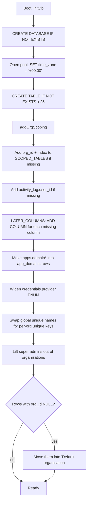
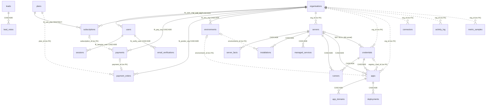

# Database Design

This document is the physical design of the panel's MySQL database: every table, column, type, key and constraint, and the rules the code follows when it reads and writes them. [Data Model](04-data-model.md) is the conceptual overview. Read that first, then use this document when you write a query, add a column or review a migration.

The source of truth is `createSchema()` and `addOrgScoping()` in `src/db/index.js`. When this document and that file disagree, the file is right.

## 1. Engine and conventions

| Setting | Value | Why |
|---------|-------|-----|
| Server | MySQL 8 | `JSON` columns, `CHECK`-free ENUMs, `information_schema` probing for migrations |
| Database | `DB_NAME` (default `auto_deploy`), created on boot if missing | No manual setup step |
| Engine | InnoDB on every table | Transactions, row locks, foreign keys |
| Charset / collation | `utf8mb4` / `utf8mb4_unicode_ci` | Full Unicode (emoji in commit messages, names). Comparisons ignore case, so `UNIQUE` on `email` is case-insensitive |
| Time zone | Session `time_zone = '+00:00'`, pool `timezone: 'Z'`, `dateStrings: true` | Every `DATETIME` is UTC. Dates come back as strings, and the browser converts them to local time |
| Primary keys | `id INT AUTO_INCREMENT` (`BIGINT` for `metric_samples`) | Simple surrogate keys. Only `metric_samples` is expected to pass 2 billion rows |
| Timestamps | `created_at DEFAULT CURRENT_TIMESTAMP`, `updated_at … ON UPDATE CURRENT_TIMESTAMP` | Maintained by MySQL, not by the code |
| Booleans | `TINYINT(1)` with `0/1` | |
| Status fields | Mostly `VARCHAR(20–30)`, not `ENUM` | New states can be added without an `ALTER`. Only `users.role`, `users.status`, `servers.auth_type`, `credentials.provider`, `runners.kind/scope` and `metric_samples.kind` are real ENUMs |
| Secrets | Columns ending `_enc` hold AES-256-GCM ciphertext. Tokens are stored as SHA-256 (`token_hash`, `code_hash`) | A database dump alone reveals no secret and no live token |
| Large text | `MEDIUMTEXT` (up to 16 MB) for logs and unit files, `TEXT` (64 KB) for errors and ciphertext | |

### Naming

- Tables are plural `snake_case`. Columns are `snake_case`.
- Foreign-key columns are `<entity>_id`. Constraints are `fk_<table>_<target>`, unique keys `uq_<…>`, plain indexes `idx_<…>`.
- Tenant column is always `org_id`.

## 2. Schema lifecycle

There is no migration tool. Every boot runs the same idempotent sequence, so a fresh database and a two-year-old one end up identical.

**How to change the schema**

| Change | Do this |
|--------|---------|
| New table | Add a `CREATE TABLE IF NOT EXISTS` to `createSchema()`. If its rows belong to a tenant, include `org_id` and an index in the definition |
| New column on an existing table | Add it to the `CREATE TABLE` **and** append `[table, column, definition]` to `LATER_COLUMNS`. The first covers new installs, the second existing ones |
| New credential provider | Add it to `PROVIDERS`. The ENUM is widened on next boot |
| New index or unique key | Probe `information_schema.statistics` first, then `ALTER TABLE … ADD`. Copy the `uq_server_org_name` block |
| Rename / drop a column | Not supported automatically. Write a guarded one-off step in `addOrgScoping()` and keep old reads working for one release |

Every step must be safe to run twice and safe against a database that is several releases behind.

## 3. Entity-relationship diagram (physical)

Solid lines are enforced foreign keys. Relationships drawn with `..` exist in the code only (see [§6](#6-referential-integrity)).

## 4. Table definitions

Legend: **PK** primary key, **FK** foreign key, **UQ** unique, **IX** index, **N** nullable. Columns marked *(later)* are added by `LATER_COLUMNS` on older databases.

### 4.1 Identity and access

#### `organisations` — a tenant

| Column | Type | N | Default | Notes |
|--------|------|---|---------|-------|
| id | INT | | auto | PK |
| name | VARCHAR(190) | | | UQ |
| slug | VARCHAR(190) | | | UQ |
| notes | TEXT | ✓ | | |
| status | VARCHAR(20) | | `'active'` | *(later)* `active` / `suspended`. Suspended members cannot sign in |
| created_at, updated_at | DATETIME | | now | |

#### `users`

| Column | Type | N | Default | Notes |
|--------|------|---|---------|-------|
| id | INT | | auto | PK |
| org_id | INT | ✓ | | FK → organisations ON DELETE CASCADE. IX `idx_user_org`. **NULL for super admins** |
| active_org_id | INT | ✓ | | The organisation a super admin has opened. No FK |
| email | VARCHAR(190) | | | UQ (case-insensitive by collation) |
| name | VARCHAR(190) | | | |
| password_hash | TEXT | | | scrypt |
| role | ENUM | | `'viewer'` | `super_admin`, `admin`, `editor`, `viewer` |
| status | ENUM | | `'active'` | `active`, `disabled` |
| phone | VARCHAR(32) | ✓ | | *(later)* Required for admins and super admins (enforced in code) |
| email_verified | TINYINT(1) | | 1 | *(later)* Self sign-ups start at 0 |
| email_verified_at | DATETIME | ✓ | | *(later)* |
| terms_version | VARCHAR(20) | ✓ | | *(later)* |
| terms_accepted_at | DATETIME | ✓ | | *(later)* |
| last_login_at | DATETIME | ✓ | | |
| created_by | INT | ✓ | | users.id, no FK |
| created_at, updated_at | DATETIME | | now | |

#### `sessions`

| Column | Type | N | Notes |
|--------|------|---|-------|
| id | INT | | PK |
| token_hash | CHAR(64) | | UQ. SHA-256 of the cookie token. The raw token is never stored |
| user_id | INT | | FK → users CASCADE. IX `idx_session_user` |
| expires_at | DATETIME | | Checked on every request |
| ip | VARCHAR(64) | ✓ | |
| user_agent | VARCHAR(255) | ✓ | |
| created_at | DATETIME | | |

#### `auth_challenges` — pending one-time codes

| Column | Type | N | Default | Notes |
|--------|------|---|---------|-------|
| id | INT | | auto | PK |
| token_hash | CHAR(64) | | | UQ. Identifies the challenge to the browser |
| purpose | VARCHAR(16) | | | Sign-in or sign-up |
| user_id | INT | ✓ | | Set for sign-in. No FK |
| payload | MEDIUMTEXT | ✓ | | Encrypted pending sign-up (the user row does not exist yet) |
| code_hash | CHAR(64) | | | SHA-256 of the OTP |
| channel | VARCHAR(10) | | | `email` / `sms` |
| sent_to | VARCHAR(190) | | | |
| attempts | INT | | 0 | Wrong guesses |
| sends | INT | | 1 | Resends |
| last_sent_at | DATETIME | | now | Resend throttle |
| expires_at | DATETIME | | | IX `idx_challenge_expiry`. Expired rows are deleted on each new challenge |
| created_at | DATETIME | | now | |

#### `email_verifications`

| Column | Type | N | Notes |
|--------|------|---|-------|
| id | INT | | PK |
| token_hash | CHAR(64) | | UQ |
| user_id | INT | | FK → users CASCADE. IX `idx_verify_user` |
| email | VARCHAR(190) | | The address being confirmed |
| expires_at | DATETIME | | |
| created_at | DATETIME | | |

### 4.2 Commerce

#### `plans`

| Column | Type | N | Default | Notes |
|--------|------|---|---------|-------|
| id | INT | | auto | PK |
| name | VARCHAR(120) | | | |
| slug | VARCHAR(120) | | | UQ |
| tagline | VARCHAR(255) | ✓ | | |
| price_monthly, price_yearly | DECIMAL(12,2) | | 0 | Money is never stored as a float |
| currency | VARCHAR(8) | | `'INR'` | |
| limits | JSON | ✓ | | See [§5](#5-json-column-shapes) |
| features | JSON | ✓ | | Array of strings shown on the pricing page |
| highlighted | TINYINT(1) | | 0 | |
| is_public | TINYINT(1) | | 1 | Hidden plans can still be assigned by a super admin |
| sort_order | INT | | 0 | |
| status | VARCHAR(20) | | `'active'` | |
| created_at, updated_at | DATETIME | | now | |

#### `subscriptions`

| Column | Type | N | Default | Notes |
|--------|------|---|---------|-------|
| id | INT | | auto | PK |
| org_id | INT | | | FK → organisations CASCADE. IX `idx_sub_org` |
| plan_id | INT | | | FK → plans (RESTRICT: a plan in use cannot be deleted). IX `idx_sub_plan` |
| cycle | VARCHAR(10) | | `'monthly'` | `monthly` / `yearly` |
| amount | DECIMAL(12,2) | | 0 | Price at the time of purchase, so later plan price changes do not rewrite history |
| currency | VARCHAR(8) | | `'INR'` | |
| status | VARCHAR(20) | | `'active'` | `active, trial, past_due, pending, declined, withdrawn, cancelled, ended` |
| started_at | DATETIME | | now | |
| renews_at | DATETIME | ✓ | | |
| expires_at | DATETIME | ✓ | | *(later)* After this the organisation is view-only |
| ended_at | DATETIME | ✓ | | |
| notes | TEXT | ✓ | | |
| created_at, updated_at | DATETIME | | now | |

#### `payments` — money received

| Column | Type | N | Notes |
|--------|------|---|-------|
| id | INT | | PK |
| org_id | INT | | FK → organisations CASCADE. IX `idx_pay_org` |
| subscription_id | INT | ✓ | subscriptions.id, no FK |
| amount | DECIMAL(12,2) | | |
| currency | VARCHAR(8) | | default `'INR'` |
| paid_at | DATETIME | | IX `idx_pay_paid` (revenue reports) |
| method | VARCHAR(40) | ✓ | e.g. `razorpay/upi`, `Bank transfer` |
| reference | VARCHAR(190) | ✓ | Gateway payment id or bank reference |
| notes | TEXT | ✓ | |
| created_by | INT | ✓ | users.id of whoever recorded it; NULL for online payments |
| created_at | DATETIME | | |

#### `payment_orders` — Razorpay orders

| Column | Type | N | Default | Notes |
|--------|------|---|---------|-------|
| id | INT | | auto | PK |
| org_id | INT | | | FK → organisations CASCADE. IX `idx_porder_org` |
| plan_id | INT | | | plans.id, no FK |
| user_id | INT | ✓ | | Who started checkout |
| cycle | VARCHAR(10) | | `'monthly'` | |
| amount | DECIMAL(12,2) | | | |
| currency | VARCHAR(8) | | `'INR'` | |
| provider | VARCHAR(20) | | `'razorpay'` | |
| provider_order_id | VARCHAR(64) | | | UQ. Look-up key for webhooks and the checkout callback |
| provider_payment_id | VARCHAR(64) | ✓ | | |
| status | VARCHAR(20) | | `'created'` | `created → paid` or `created → failed` |
| error | VARCHAR(500) | ✓ | | |
| payment_id | INT | ✓ | | payments.id once paid, no FK |
| paid_at | DATETIME | ✓ | | |
| created_at, updated_at | DATETIME | | now | |

#### `leads`

| Column | Type | N | Notes |
|--------|------|---|-------|
| id | INT | | PK |
| name, email | VARCHAR(190) | | IX `idx_lead_email` |
| phone | VARCHAR(40) | ✓ | |
| company | VARCHAR(190) | ✓ | |
| servers | VARCHAR(20) | ✓ | Self-reported fleet size band |
| plan_id | INT | ✓ | No FK |
| cycle | VARCHAR(10) | ✓ | |
| message | TEXT | ✓ | |
| form | VARCHAR(30) | | default `'contact'` |
| source | VARCHAR(60) | ✓ | |
| utm_source / medium / campaign / term / content | VARCHAR(120) | ✓ | |
| referrer, landing_path | VARCHAR(500) | ✓ | |
| ip | VARCHAR(64) | ✓ | |
| user_agent | VARCHAR(255) | ✓ | |
| device, visit, geo | JSON | ✓ | *(later)* |
| visitor_id | VARCHAR(64) | ✓ | *(later)* |
| fingerprint | CHAR(64) | ✓ | *(later)* |
| country | VARCHAR(2) | ✓ | *(later)* ISO code |
| status | VARCHAR(20) | | `new → contacted → qualified → proposal → won / lost`. IX `idx_lead_status` |
| value | DECIMAL(12,2) | ✓ | Expected deal size |
| assigned_to | INT | ✓ | users.id, no FK |
| lost_reason | VARCHAR(190) | ✓ | |
| org_id | INT | ✓ | Set when converted into an organisation |
| contacted_at, closed_at | DATETIME | ✓ | |
| created_at, updated_at | DATETIME | | IX `idx_lead_created` |

#### `lead_notes`

| Column | Type | N | Notes |
|--------|------|---|-------|
| id | INT | | PK |
| lead_id | INT | | FK → leads CASCADE. IX `idx_note_lead` |
| user_id | INT | ✓ | Author |
| kind | VARCHAR(20) | | default `'note'`; also status-change events |
| body | TEXT | | |
| created_at | DATETIME | | |

### 4.3 Infrastructure

#### `servers`

| Column | Type | N | Default | Notes |
|--------|------|---|---------|-------|
| id | INT | | auto | PK |
| org_id | INT | ✓ | | *(later)* IX `idx_servers_org`. UQ `uq_server_org_name (org_id, name)` |
| name | VARCHAR(190) | | | |
| host | VARCHAR(255) | | | IP or hostname |
| port | INT | | 22 | |
| username | VARCHAR(190) | | | |
| auth_type | ENUM | | `'password'` | `password`, `key` |
| password_enc, private_key_enc, passphrase_enc, sudo_password_enc | TEXT | ✓ | | Encrypted |
| host_key | VARCHAR(128) | ✓ | | *(later)* Fingerprint pinned on first connect |
| tags | VARCHAR(500) | ✓ | | Comma-separated |
| notes | TEXT | ✓ | | |
| status | VARCHAR(30) | | `'unknown'` | `online / offline / unknown` |
| last_error | TEXT | ✓ | | |
| last_checked_at | DATETIME | ✓ | | |
| created_at, updated_at | DATETIME | | now | |

> The `CREATE TABLE` still declares `name … UNIQUE`. On boot that single-column unique index is dropped and replaced by `uq_server_org_name`.

#### `server_facts` — profile snapshots

| Column | Type | N | Notes |
|--------|------|---|-------|
| id | INT | | PK |
| server_id | INT | | FK → servers CASCADE |
| collected_at | DATETIME | | IX `idx_server_collected (server_id, collected_at DESC)` |
| duration_ms | INT | ✓ | |
| payload | JSON | | OS, CPU, memory, disks, installed software |

Latest snapshot per server is read with `WHERE id IN (SELECT MAX(id) … GROUP BY server_id)`.

#### `installations` — catalog services (databases, caches, tools) on a server

| Column | Type | N | Default | Notes |
|--------|------|---|---------|-------|
| id | INT | | auto | PK |
| org_id | INT | ✓ | | *(later)* IX |
| server_id | INT | | | FK → servers CASCADE. UQ `uq_install_name (server_id, name)` |
| kind | VARCHAR(40) | | | Catalog key, e.g. `mysql`, `redis` |
| name | VARCHAR(190) | | | Container name |
| image, tag | VARCHAR | ✓ | | |
| port, container_port | INT | ✓ | | Host and container ports |
| extra_ports | JSON | ✓ | | *(later)* |
| network, volume | VARCHAR(190) | ✓ | | Docker network and named volume |
| container_id | VARCHAR(90) | ✓ | | |
| settings | JSON | ✓ | | Non-secret options |
| secrets_enc | TEXT | ✓ | | Encrypted passwords |
| environment_id | INT | ✓ | | *(later)* No FK |
| status | VARCHAR(30) | | `'pending'` | |
| last_error | TEXT | ✓ | | |
| install_log | MEDIUMTEXT | ✓ | | |
| created_at, updated_at | DATETIME | | now | |

#### `managed_services` — systemd units created by the panel

| Column | Type | N | Notes |
|--------|------|---|-------|
| id | INT | | PK |
| org_id | INT | ✓ | *(later)* IX |
| server_id | INT | | FK → servers CASCADE. UQ `uq_service_unit (server_id, unit)` |
| unit | VARCHAR(190) | | e.g. `myworker.service` |
| description | VARCHAR(255) | ✓ | |
| exec_start | TEXT | ✓ | |
| unit_file | MEDIUMTEXT | ✓ | Full text as written to the server |
| created_at, updated_at | DATETIME | | |

#### `runners` — GitHub / GitLab CI runners

| Column | Type | N | Default | Notes |
|--------|------|---|---------|-------|
| id | INT | | auto | PK |
| org_id | INT | ✓ | | *(later)* IX |
| name | VARCHAR(190) | | | UQ `uq_runner_target_name (credential_id, target, name)` |
| credential_id | INT | | | FK → credentials CASCADE (a git credential) |
| server_id | INT | | | FK → servers CASCADE. IX `idx_runner_server` |
| kind | ENUM | | `'github'` | `github`, `gitlab` |
| scope | ENUM | | `'repo'` | `repo`, `org` |
| target | VARCHAR(255) | | | `owner/repo` or org name |
| labels | VARCHAR(500) | ✓ | | |
| runner_dir, service_name, service_user | VARCHAR | ✓ | | Where and how it runs on the server |
| remote_id | VARCHAR(60) | ✓ | | The runner's id at GitHub/GitLab |
| status | VARCHAR(30) | | `'pending'` | |
| last_error | TEXT | ✓ | | |
| install_log | MEDIUMTEXT | ✓ | | |
| created_at, updated_at | DATETIME | | now | |

#### `connectors` — PC relays

| Column | Type | N | Notes |
|--------|------|---|-------|
| id | INT | | PK |
| org_id | INT | ✓ | IX `idx_connectors_org` |
| name | VARCHAR(190) | | |
| token_hash | CHAR(64) | | UQ `uq_connector_token` |
| hostname, platform, version | VARCHAR | ✓ | Reported by the connector on connect |
| last_ip | VARCHAR(64) | ✓ | |
| last_seen_at | DATETIME | ✓ | |
| created_at | DATETIME | | |

#### `metric_samples` — time series for charts

| Column | Type | N | Notes |
|--------|------|---|-------|
| id | BIGINT | | PK |
| org_id | INT | ✓ | |
| kind | ENUM | | `server`, `app` |
| target_id | INT | | servers.id or apps.id, depending on `kind`. No FK (polymorphic) |
| at | DATETIME | | Sample time (UTC) |
| cpu_pct, memory_pct, disk_pct | DECIMAL(6,1) | ✓ | 0–100 |
| load_pct | DECIMAL(7,1) | ✓ | Load ÷ cores × 100, can exceed 100 |
| net_rx_bps, net_tx_bps | BIGINT | ✓ | |
| level | VARCHAR(10) | | default `'ok'` |

Indexes: `idx_metric_target (kind, target_id, at)` serves every chart query; `idx_metric_at (at)` serves the retention delete.

### 4.4 Credentials and configuration

#### `credentials`

| Column | Type | N | Default | Notes |
|--------|------|---|---------|-------|
| id | INT | | auto | PK |
| org_id | INT | ✓ | | *(later)* IX. UQ `uq_cred_org_provider_name (org_id, provider, name)` |
| provider | ENUM | | | `git, dockerhub, cloudflare, mysql, postgres, mongodb, redis, elasticsearch` (from `PROVIDERS`) |
| name | VARCHAR(190) | | | |
| username | VARCHAR(190) | ✓ | | |
| secret_enc | TEXT | | | Encrypted token, password or OAuth access token |
| extra | JSON | ✓ | | See [§5](#5-json-column-shapes) |
| server_id | INT | ✓ | | FK → servers ON DELETE SET NULL. SSH tunnel for database credentials |
| status | VARCHAR(30) | | `'unverified'` | `unverified / verified / error` |
| last_error | TEXT | ✓ | | |
| verified_at | DATETIME | ✓ | | |
| created_at, updated_at | DATETIME | | now | |

#### `environments` — named variable sets

| Column | Type | N | Notes |
|--------|------|---|-------|
| id | INT | | PK |
| org_id | INT | | FK → organisations CASCADE. UQ `uq_env_name (org_id, name)` |
| name | VARCHAR(120) | | |
| description | VARCHAR(255) | ✓ | |
| env_enc | MEDIUMTEXT | ✓ | Encrypted `KEY=value` set |
| var_count | INT | | Denormalised so lists need no decryption |
| created_by | INT | ✓ | |
| created_at, updated_at | DATETIME | | |

#### `projects` — legacy, unused

`id, org_id, name (UQ), server_id, git_cred_id, docker_cred_id, cf_cred_id, repo_url, branch, domain, config JSON, created_at, updated_at`, with `SET NULL` foreign keys to `servers` and `credentials`. No route reads or writes it. `apps` replaced it. It is a candidate for removal (see [Limitations & Roadmap](08-limitations-and-roadmap.md)).

### 4.5 Delivery

#### `apps`

| Column | Type | N | Default | Notes |
|--------|------|---|---------|-------|
| id | INT | | auto | PK |
| org_id | INT | ✓ | | IX `idx_app_org` |
| server_id | INT | | | FK → servers CASCADE. UQ `uq_app_name (server_id, name)` |
| credential_id | INT | | | FK → credentials CASCADE (git) |
| registry_cred_id | INT | ✓ | | Docker Hub credential. No FK |
| environment_id | INT | ✓ | | *(later)* No FK |
| name | VARCHAR(190) | | | |
| repo | VARCHAR(255) | | | |
| branch | VARCHAR(190) | | | |
| root_dir | VARCHAR(255) | ✓ | | *(later)* Monorepo subfolder |
| app_type | VARCHAR(30) | | `'node'` | *(later)* Build strategy |
| node_version | VARCHAR(20) | ✓ | | |
| install_cmd, build_cmd, start_cmd | VARCHAR(500) | ✓ | | |
| output_dir | VARCHAR(190) | ✓ | | *(later)* Static builds |
| port | INT | | | Host port |
| container_port | INT | | | |
| instances | INT | | 1 | *(later)* Replica count |
| container_ports | JSON | ✓ | | *(later)* Per-instance host ports |
| containers | JSON | ✓ | | *(later)* Running container ids |
| volumes | JSON | ✓ | | *(later)* |
| image, tag | VARCHAR | ✓ | | Built image |
| image_bytes | BIGINT | ✓ | | |
| pushed | TINYINT(1) | | 0 | Pushed to Docker Hub |
| network | VARCHAR(190) | ✓ | | |
| restart | VARCHAR(30) | | `'unless-stopped'` | Docker restart policy |
| use_repo_dockerfile | TINYINT(1) | | 0 | |
| env_enc | TEXT | ✓ | | Encrypted app-specific variables |
| detected | JSON | ✓ | | What repo inspection found (framework, package manager…) |
| container_id | VARCHAR(90) | ✓ | | |
| status | VARCHAR(30) | | `'pending'` | `pending, deploying, running, configuring, error, failed, interrupted, removing, remove_failed` |
| last_error | TEXT | ✓ | | |
| deploy_log | MEDIUMTEXT | ✓ | | Latest deploy, tokens scrubbed |
| deploy_started_at | DATETIME | ✓ | | *(later)* Detects deploys interrupted by a restart |
| last_deployed_at | DATETIME | ✓ | | |
| auto_deploy | TINYINT(1) | | 0 | *(later)* |
| auto_deploy_trigger | VARCHAR(10) | | `'push'` | *(later)* `push` / `merge` |
| webhook_token | VARCHAR(64) | ✓ | | *(later)* Secret in the webhook URL |
| webhook_id | VARCHAR(64) | ✓ | | *(later)* Id at the git host |
| deployed_sha, deployed_message | VARCHAR | ✓ | | *(later)* |
| auto_seen_sha | VARCHAR(64) | ✓ | | *(later)* Last commit the poller saw |
| auto_checked_at | DATETIME | ✓ | | *(later)* |
| auto_error | TEXT | ✓ | | *(later)* |
| domain, domain_config, domain_status, domain_error, domain_log | | ✓ | | *(later)* **Deprecated.** Moved into `app_domains` on boot and set to NULL |
| created_at, updated_at | DATETIME | | now | |

#### `app_domains`

| Column | Type | N | Default | Notes |
|--------|------|---|---------|-------|
| id | INT | | auto | PK |
| org_id | INT | ✓ | | UQ `uq_app_domain (org_id, domain)`: one org cannot attach a domain twice |
| app_id | INT | | | FK → apps CASCADE. IX `idx_domain_app` |
| domain | VARCHAR(255) | | | |
| port | INT | ✓ | | Which app port it serves, for multi-port apps |
| config | JSON | ✓ | | See [§5](#5-json-column-shapes) |
| status | VARCHAR(30) | | `'pending'` | |
| error | TEXT | ✓ | | |
| log | MEDIUMTEXT | ✓ | | |
| created_at, updated_at | DATETIME | | now | |

#### `deployments`

| Column | Type | N | Default | Notes |
|--------|------|---|---------|-------|
| id | INT | | auto | PK |
| org_id | INT | ✓ | | |
| app_id | INT | | | FK → apps CASCADE. IX `idx_deploy_app (app_id, id)` |
| trigger | VARCHAR(20) | | `'manual'` | Reserved word, always quoted with backticks. `first` (initial deploy), `manual`, or the auto-deploy trigger passed in `meta.trigger` |
| reason | VARCHAR(500) | ✓ | | |
| user_id | INT | ✓ | | |
| branch | VARCHAR(190) | ✓ | | |
| kind | VARCHAR(10) | ✓ | | `commit` / `merge` |
| sha | VARCHAR(64) | ✓ | | |
| message | VARCHAR(255) | ✓ | | Truncated to 255 in code |
| author | VARCHAR(190) | ✓ | | |
| committed_at | DATETIME | ✓ | | |
| pr_number | VARCHAR(20) | ✓ | | |
| pr_title | VARCHAR(255) | ✓ | | |
| pr_from | VARCHAR(190) | ✓ | | Source branch |
| status | VARCHAR(20) | | `'running'` | |
| error | TEXT | ✓ | | |
| log | MEDIUMTEXT | ✓ | | |
| started_at | DATETIME | | now | |
| finished_at | DATETIME | ✓ | | |

### 4.6 Audit

#### `activity_log`

| Column | Type | N | Notes |
|--------|------|---|-------|
| id | INT | | PK |
| org_id | INT | ✓ | *(later)* IX `idx_activity_log_org` |
| user_id | INT | ✓ | *(later)* |
| entity | VARCHAR(50) | | Table-like name, e.g. `server`, `app`, `plan` |
| entity_id | INT | ✓ | Polymorphic, no FK |
| action | VARCHAR(60) | | e.g. `created`, `plan_chosen`, `terminal_opened` |
| level | VARCHAR(20) | | `info / warn / error` |
| message | TEXT | ✓ | |
| created_at | DATETIME | | IX `idx_created (created_at DESC)` |

Written only through `logActivity()`, which takes `org_id` and `user_id` from the request context and swallows its own errors so auditing never fails a request.

## 5. JSON column shapes

MySQL does not validate these. The shapes below are what the code writes and expects.

| Column | Shape |
|--------|-------|
| `plans.limits` | `{ "servers": 3, "apps": 10, "users": 5, "databases": 2, "domains": 5 }`. Missing or `null` key means unlimited |
| `plans.features` | `["Auto deploy", "Custom domains", …]` |
| `credentials.extra` | Provider-specific: `host`, `port`, `database` and `tls` for DB credentials (for Elasticsearch `database` is the default index for the query console, and `tls` means HTTPS); OAuth `refresh_token_enc`, `expires_at`, account login for git; account id/zone info for Cloudflare |
| `app_domains.config` | `{ "mode": "dns" \| "zerotrust" \| "nginx", … }`. `dns` / `zerotrust`: `credentialId`, `proxied`, `email`, tunnel ids needed to remove it later. `nginx` (direct, no Cloudflare): `{ "mode": "nginx", "ssl": true \| false, "email": … }` |
| `apps.container_ports` | Array of host ports, one per instance |
| `apps.volumes` | `[{ "source": "...", "target": "/data" }]` |
| `apps.containers` | Array of container ids/names for multi-instance apps |
| `apps.detected` | Result of repo inspection (framework, package manager, suggested commands) |
| `installations.settings` | Non-secret catalog options |
| `server_facts.payload` | OS, kernel, CPU, memory, disks, installed packages and versions |
| `leads.device`, `visit`, `geo` | Browser-reported device info, visit path, IP-derived location |

When you add a key, read it with a fallback (`cfg?.key ?? default`) because older rows will not have it.

## 6. Referential integrity

### Enforced by MySQL

| Parent → child | On delete |
|----------------|-----------|
| organisations → users, subscriptions, payments, payment_orders, environments | CASCADE |
| users → sessions, email_verifications | CASCADE |
| plans → subscriptions | RESTRICT |
| servers → server_facts, installations, managed_services, runners, apps | CASCADE |
| servers → credentials.server_id | SET NULL |
| credentials → runners, apps | CASCADE |
| apps → app_domains, deployments | CASCADE |
| leads → lead_notes | CASCADE |

### Enforced only in code

`org_id` on `servers, credentials, apps, app_domains, deployments, installations, runners, managed_services, connectors, activity_log, metric_samples` has **no foreign key**. The column was added after the tables existed and had to accept `NULL` during migration. Consequences:

- Deleting an organisation cascades to users, billing and environments, but **not** to its servers, credentials or apps. `DELETE /organisations/:id` (`src/routes/team.js`) therefore refuses while the organisation still holds servers, credentials or members. Any other code path that deletes an organisation must do the same check, or it leaves orphans that no tenant can see.
- Every tenant query must filter on `org_id`. The database will not stop a query that forgets.

Other soft references: `apps.registry_cred_id`, `apps.environment_id`, `installations.environment_id`, `payments.subscription_id`, `payment_orders.plan_id/payment_id/user_id`, `leads.plan_id/org_id/assigned_to`, `users.active_org_id/created_by`, `deployments.user_id`, `activity_log.user_id`. Code that reads them must handle a missing parent (use `LEFT JOIN`).

## 7. Multi-tenancy rules

1. A row belongs to exactly one organisation through `org_id`. Rows under a server (`server_facts`, `installations`…) also inherit tenancy from `servers.org_id`.
2. Every read of a tenant table filters `WHERE org_id = ?` with the org from the request context, never from the request body.
3. Every insert sets `org_id` from the context.
4. Names are unique **per organisation** (`uq_server_org_name`, `uq_cred_org_provider_name`, `uq_env_name`, `uq_app_domain`), so one tenant cannot learn which names another uses.
5. Super admins have `users.org_id = NULL`. They work inside a tenant by setting `active_org_id`, which becomes the context org.
6. Platform-level tables have no `org_id`: `plans`, `leads`, `lead_notes`, `auth_challenges`.

## 8. Important query patterns

| Need | Query shape | Index used |
|------|-------------|------------|
| Current subscription | `WHERE org_id = ? AND status IN ('active','trial','past_due') ORDER BY id DESC LIMIT 1` | `idx_sub_org` |
| Latest facts per server | `WHERE id IN (SELECT MAX(id) FROM server_facts GROUP BY server_id)` | PK + `idx_server_collected` |
| Deploy history | `WHERE app_id = ? ORDER BY id DESC LIMIT n` | `idx_deploy_app` |
| Chart data | `WHERE kind = ? AND target_id = ? AND at >= ?` | `idx_metric_target` |
| Session check | `WHERE token_hash = ?` | UQ on `token_hash` |
| Webhook look-up | `apps WHERE webhook_token = ?` | **none** — full scan of `apps` (fine at current sizes) |
| Mark order paid (idempotent) | `UPDATE payment_orders SET status='paid' … WHERE id = ? AND status <> 'paid'`, act only if `affectedRows = 1` | PK |

## 9. Retention and growth

| Table | Growth | Retention today |
|-------|--------|-----------------|
| `metric_samples` | 1 row per server and app every `METRICS_EVERY_MINUTES` (5) | Deleted after `METRICS_KEEP_DAYS` (35, minimum 7) |
| `deployments` | 1 row per deploy, with full log | Last **50** per app kept |
| `auth_challenges` | 1 row per OTP | Expired rows deleted when a new challenge is made |
| `email_verifications` | 1 per verification email | Deleted when used or re-sent |
| `server_facts` | 1 row per profile run (JSON payload) | **Not pruned** |
| `activity_log` | Every change and event | **Not pruned** |
| `sessions` | 1 per sign-in | Deleted on sign-out / password change; expired rows are rejected but **not purged** |

**Sizing guide.** 100 servers + 300 apps at 5-minute samples is about 115,000 `metric_samples` rows a day, about 4 million at 35 days (roughly 400–500 MB with indexes). Everything else is small next to that and to `MEDIUMTEXT` logs.

## 10. Recommended improvements

Ordered by value.

1. **Prune `server_facts`, `activity_log` and expired `sessions`** with the same timer that prunes `metric_samples` (for example keep 20 fact snapshots per server, 180 days of activity).
2. **Index `apps.webhook_token`** (`UNIQUE`). Every webhook call scans `apps` today.
3. **Add `activity_log (org_id, created_at)`** as one composite index. The org-filtered, newest-first activity page then needs no sort.
4. **Make `org_id` `NOT NULL` with a foreign key** on the tenant tables once every installation has run the Default-organisation migration. The database would then enforce what the organisation-delete check does today.
5. **Drop the `projects` table** and the deprecated `apps.domain*` columns.
6. **Add foreign keys** for `payment_orders.plan_id` and `apps.registry_cred_id` (`SET NULL`).
7. **Partition or roll up `metric_samples`** (hourly averages after 7 days) if fleets grow past a few thousand targets.

## 11. Backup and restore

See [Data Model §5](04-data-model.md#5-backup-guidance) and [Deployment & Operations](07-deployment-and-operations.md). The two points that matter for design:

- `mysqldump --single-transaction` gives a consistent snapshot because every table is InnoDB.
- Every `_enc` column is only usable with the same master key, so back up the key separately and together with each dump's date.
